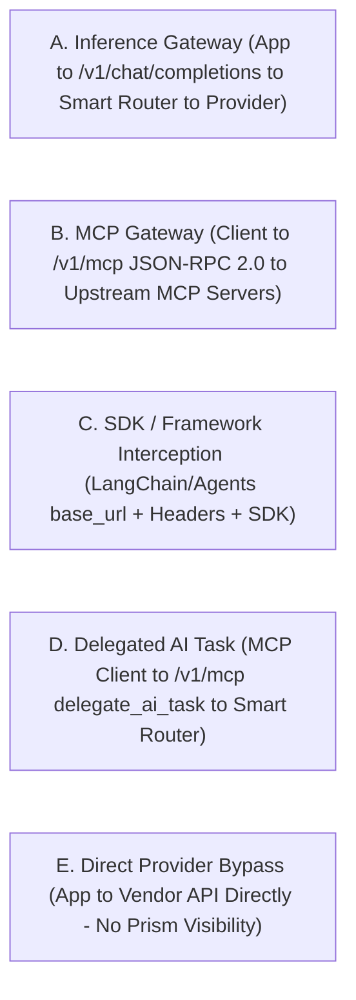
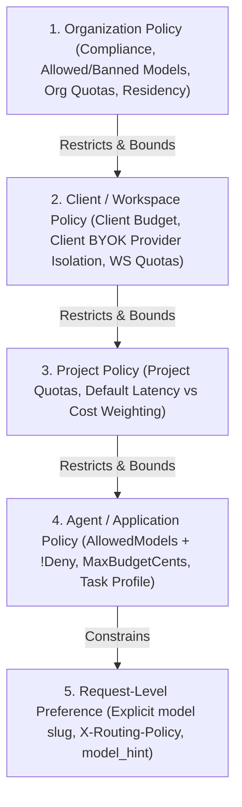

# Prism — Universal AI Integration Strategy & Platform Interoperability

**Document Purpose:** Define how Prism operates as an enforceable AI Control Plane across a heterogeneous ecosystem of AI applications, coding assistants, agent frameworks, and workflow engines — without depending on any single client or making unenforceable control claims.

---

## 1. Ecosystem Overview

Real-world AI automation agencies and engineering organizations run **heterogeneous** stacks simultaneously:
- **Interactive AI Applications & Coding Assistants:** Claude Code, Cursor, Claude Desktop, OpenCode, Windsurf/Cline/Continue, internal chat UIs.
- **Agent Frameworks & SDKs:** LangChain, LangGraph, CrewAI, AutoGen, OpenAI Agents SDK, custom Python/TypeScript runtimes, Paperclip agents.
- **Workflow & Tool Runtimes:** n8n, Make/Zapier HTTP webhooks, custom automation workers, standalone MCP servers & clients.
- **Multi-Agent Orchestrations:** Supervisor agents using flagship reasoning models while delegating classification, extraction, formatting, or summarization subtasks to specialized worker models/agents.

Most of these tools already bring their own model dropdowns, local credentials, tool loops, memory, and workflow state. Prism must deliver measurable governance and cost control **despite** those client-owned features, strictly within technical enforcement boundaries.

---

## 2. Five Reusable Integration Patterns

Instead of bespoke per-vendor integrations, Prism standardizes around five explicit patterns:

| Pattern | Architecture Path | Primary Value Delivered | What Prism Enforces | What Prism Cannot Enforce |
|---|---|---|---|---|
| **A. Inference Gateway** | App → `/v1/chat/completions` (or planned `/v1/messages`) → Admission → Smart Router → Provider | BYOK custody, rate limits, smart routing, failover, budget/quota caps, request/cost attribution | Model allow/deny lists, tenant/agent quotas & budgets, credential selection, failover, logging | Client-side tool execution after completion returns |
| **B. MCP Gateway** | MCP Client → `POST /v1/mcp` → Admission → Upstream MCP (`server__tool`) | Centralized MCP tool discovery & execution, upstream secret custody, per-agent server/tool allow/deny, invocation audit | Which MCP servers & tools an agent sees (`tools/list`) and executes (`tools/call`), RBAC, quotas | Primary chat inference in clients using native vendor subscriptions |
| **C. SDK / Framework Integration** | LangChain / CrewAI / OpenAI Agents SDK → Prism `/v1` (`base_url` + headers) ± `/v1/mcp` ± TypeScript/Python Admin SDK | Clean runtime attribution (`X-Prism-Agent-ID`, `X-Prism-Workspace-ID`, `Idempotency-Key`, `X-Routing-Policy`) | Everything in Patterns A & B when calls route via Prism endpoints | Non-AI Python/Node code (filesystem, local bash) unless routed through Prism Tool/MCP Gateway |
| **D. Delegated AI Task** | Host Agent/App → `POST /v1/mcp` (`delegate_ai_task`) → Orchestrator → Smart Router → Provider | Offloads high-volume subtasks from flagship models (e.g. Opus) to policy-selected models with explicit cost & model disclosure | Task routing policy, agent model allowlists, hard budget reserve, token/cost logging | Host app's own parent turn prior to/after `delegate_ai_task` |
| **E. Direct Provider Bypass** | App / Script → `api.openai.com` / `api.anthropic.com` / `generativelanguage.googleapis.com` directly | **None (Out-of-Band Bypass)** | **Nothing** — zero visibility, zero metering, zero policy enforcement | Cannot inspect, budget, or block traffic that never enters Prism |

---

## 3. Evidence-Based Platform Compatibility Matrix

Each row distinguishes **Theoretical/Vendor Client Capability** from **Verified Current Prism Backend Capability** (`main` + Phase 4).

| Platform / Runtime | 1. Route Inference via Prism | 2. Delegate Model Selection (`prism-auto`) | 3. Prism Manages Provider Credentials | 4. Govern Tool Calls via Prism | 5. Associate Prism Agent Identity | 6. Enforce Execution Permissions | 7. Client/Project Cost Attribution | 8. Activity Audit | 9. Practical Mechanism | 10. Verified Technical Limitations & Gaps |
|---|---|---|---|---|---|---|---|---|---|---|
| **OpenAI-Compatible Apps & SDKs** (OpenAI Python/Node SDK, custom chat UIs) | **Yes** (`/v1/chat/completions`) | **Yes** (`model: "prism-auto"` + `X-Routing-Policy`) | **Yes** (OpenAI upstream works; Anthropic/Google translation buggy) | **Partial** (via `/v1/tools/*` or `/v1/mcp`, not inline loop) | **Yes** (opt-in `X-Prism-Agent-ID`; keys lack `agent_id` binding) | **Yes** (models, tools, resources, MCP, quotas, budgets) | **Yes** (`org_id`/`ws_id`/`proj_id` pinned on key) | **Yes** (async hash uses metadata surrogate) | OpenAI `base_url` -> `https://api.../v1` | Missing OpenAI `/v1/responses` endpoint; `temperature: 0` dropped; Anthropic & Responses adapters broken for multi-turn tools |
| **Claude Code** | **No (Blocked — P1)** | Not until `/v1/messages` exists | Yes for MCP upstream; Inference blocked | **Yes** (via HTTP MCP `POST /v1/mcp`) | **Partial** (`X-Prism-Agent-ID` custom header in MCP config) | **Yes on MCP tools**; No on local Bash/Edit/Read | MCP audit only until `/v1/messages` added | MCP calls audited | MCP config now; `ANTHROPIC_BASE_URL` planned | `POST /v1/messages` is **not implemented** (`cmd/server/main.go`); Anthropic streaming tool deltas incomplete; local bash/fs outside Prism |
| **Claude Desktop** | **No** (no general custom inference override) | **Via `delegate_ai_task` only** | Yes for MCP upstream & delegated LLM calls | **Yes** (when tools exposed via Prism `/v1/mcp`) | **Yes** (`X-Prism-Agent-ID` header in MCP server config) | **Yes on Prism MCP tools & delegated tasks** | Delegated tasks & MCP calls attributed | MCP & delegated inference audited | `POST /v1/mcp` (Streamable HTTP) | Primary vendor chat turns go direct to Anthropic; requires client stdio-to-HTTP bridge or HTTP MCP support |
| **Cursor** | **Conditional** (depends on custom OpenAI base URL + OpenAI chat compat; subscription features may bypass) | **Yes** when pointed at OpenAI-compat `/v1` (`prism-auto` custom model) | **Yes** when using Prism BYOK endpoint | **Yes** via Cursor MCP -> `POST /v1/mcp` | **Yes** (header on MCP / custom endpoint) | Enforced on Prism `/v1` & `/v1/mcp` only | Enforced on routed traffic | Routed calls & MCP logged | Custom OpenAI API Base URL + Cursor MCP JSON | Cursor proprietary Tab/Composer/managed subscription calls bypass Prism; Cursor local terminal tools outside Prism |
| **OpenCode** | **Yes** (UA detected at `gateway.go:784`) | **Yes** | **Yes** | **Yes** via `/v1/mcp` or `/v1/tools/*` | **Yes** via header | Same as OpenAI-compat + MCP | Yes | Yes | `base_url` + custom headers / MCP | `OpenCodeAdapter` routes `gpt-*`/`grok-*` to broken `OpenAIResponsesAdapter` (`opencode.go:22-25`) |
| **LangChain / LangGraph** | **Yes** (`ChatOpenAI(base_url=...)`) | **Yes** (`model="prism-auto"`, `default_headers={"X-Routing-Policy": ...}`) | **Yes** | **Yes** (LangChain MCP adapter -> `/v1/mcp` or custom tool calling `/v1/tools/*`) | **Yes** (`default_headers={"X-Prism-Agent-ID": ...}`) | **Yes** on LLM + Prism tools/MCP | **Yes** per client gateway key / WS / Proj header | Yes | Standard OpenAI SDK `base_url` + headers + MCP | Native LangGraph state & local Python `@tool` functions execute in app process unless wrapped to call `/v1/tools/*` or `/v1/mcp` |
| **CrewAI / AutoGen / OpenAI Agents SDK** | **Yes** via OpenAI-compat `/v1/chat/completions` | **Yes** (per-crew/agent `model="prism-auto"`) | **Yes** | **Yes** via MCP client or `/v1/tools/*` | **Yes** (per-agent `default_headers`) | **Yes** at gateway & MCP boundary | **Yes** per agent & tenant key | Yes | OpenAI client override per Agent instance | OpenAI Agents SDK Responses-native features fail (no `/v1/responses`); native local code execution tools bypass Prism |
| **n8n & Workflow Platforms** | **Yes** (OpenAI node Base URL -> Prism `/v1`) | **Yes** (`model="prism-auto"`) | **Yes** (removes scattered API keys from n8n credentials) | **Yes** (HTTP Request node -> `/v1/tools/*`, `/v1/resources/*`, `/v1/mcp`) | **Yes** (header per workflow credential) | **Yes** for AI/Tool/MCP nodes | **Yes** per client n8n credential / workspace key | Yes | OpenAI credential override + HTTP/MCP Client node | Non-AI n8n nodes (SaaS triggers, email, webhooks) stay outside Prism governance |
| **Prism TS / Python SDKs & CLI** | Partial | Needs verification | Admin CRUD only | Mismatched contract (needs fix) | Partial | Calls `/v1/tools/*` | Missing tenant headers in several SDK methods | Partial | `@prism/sdk`, `prism` CLI | Subagent audit flagged payload mismatches (`args` vs `input`, unimplemented `/v1/responses` / `/api` route alignment) — flagged P1 |

---

## 4. Model Selection Responsibility & Routing Policy Hierarchy

Because AI applications may pass an explicit model, defer to `"prism-auto"`, or operate under client budget pressure, Prism defines the **5-Tier Routing Policy Hierarchy**:

### Conflict Resolution Rules (Implemented vs Target)

| Scenario | Conflict Resolution Rule | Current Prism Behavior | Gap |
|---|---|---|---|
| **User/App Pins Explicit Model** (`gpt-4o`, `claude-3-7-sonnet`) | **Never silently swap an explicit model unless an explicit policy/org constraint forbids it** (then deny with `403`, or fallback ONLY if explicitly configured). Provider selection rules (`routing_rules`) may pick which provider supplies that exact slug. | `ResolveWithFallback` honors explicit model + checks `gatewayKey.AllowedModels` and `agent.AllowedModels`; `google.go:38-40` **buggily rewrites** `gemini-2.0-flash` -> `gemini-3.6-flash` (**active bug**). | Fix `google.go` hardcoded rewrite; add explicit "deny vs allow vendor fallback" flag. |
| **App Delegates Selection** (`model: "prism-auto"` or `delegate_ai_task` default) | Resolve active policy (`X-Routing-Policy` -> default policy -> built-in `balanced`), intersect candidates with `Org/WS/Agent.AllowedModels` + active tenant credentials + non-cooling state, score deterministically, log full score breakdown. | `engine.go` + `router.go` resolves `X-Routing-Policy` (Phase 4 enabled on `/v1/chat/completions`), applies `budgetStatus` penalty, and (Phase 4) filters candidates via `CheckAgentResolvedModel`. | `routing_policies`, `routing_rules`, and `budgets` schemas are still `user_id`-scoped rather than true Org → Workspace → Project inheritance. |
| **Hard Budget Exceeded (`HardLimit: true`)** | Deny admission (`429`) instead of running unapproved model. | Enforced atomically via `AdmissionController` + `BudgetManager.Reserve` (single-replica). | Multi-replica distributed reservation (Redis Lua) needed for horizontal scaling. |

---

## 5. Five Levels of Control (No False Universal Claims)

| Control Level | Definition | Example in Prism Today |
|---|---|---|
| **1. Integration Availability** | A client can speak HTTP/OpenAI/MCP to Prism. | `/v1/chat/completions`, `/v1/mcp` JSON-RPC 2.0. |
| **2. Request Visibility** | Prism sees metadata/tokens of traffic sent to it. | Passive logs when clients use OpenAI SDK; zero visibility into direct vendor calls. |
| **3. Policy Evaluation** | Rules are scored/checked in memory. | `POST /api/routing/simulate` evaluates rules without executing traffic (currently diverges from live routing). |
| **4. Policy Enforcement** | Execution is **blocked (`403`/`429`/`-32001`) before** external side effects occur. | Phase 4 enforced `AdmissionController` + `!deny` + quotas + budgets on `/v1/chat/completions`, `/v1/mcp`, `/v1/tools/*`, `/v1/resources/*`. |
| **5. Execution Observability** | Tamper-evident audit & accurate latency/cost telemetry persisted durably. | `request_logs` & `ai_audit_trails` recorded (async best-effort channels today; transactional outbox & true payload hashes needed for financial durability). |

---

## 6. Mitigating Direct Provider Bypass (Pattern E)

Prism **cannot** magically intercept encrypted TLS traffic sent straight from an employee's laptop to `api.openai.com` unless the network enforces an egress proxy. Practical, honest agency controls to encourage and enforce Prism adoption:
1. **Zero Scattered Vendor Keys (Credential Custody):** Store vendor keys (`sk-*`, Anthropic keys) **exclusively inside Prism**, handing developers/workflows only scoped, revocable `prism_sk_*` keys pinned to client `WorkspaceID` and `ProjectID`. Without raw vendor keys on developer laptops or n8n exports, direct bypass is impossible.
2. **One-Line Drop-In Interoperability:** Expose standard `/v1/chat/completions`, `/v1/messages` (P1), and `POST /v1/mcp` endpoints so migrating from direct vendor URLs takes changing `BASE_URL` and `API_KEY` only.
3. **Egress Network Firewall (Optional Agency Enterprise Deployment):** In agency-hosted agent containers/Kubernetes clusters, restrict outbound HTTPS on LLM API domains to Prism's gateway egress.

---

## 7. Concrete Implementation Gaps Remaining for Universal Interoperability

1. **P1:** Expose **`POST /v1/messages`** (Anthropic Messages API endpoint + proper Anthropic SSE/tool_use/thinking/multi-turn translation) for native Claude Code (`ANTHROPIC_BASE_URL`) and Anthropic SDK clients.
2. **P1:** Fix **`OpenAIResponsesAdapter`**, **`AnthropicAdapter`**, **`GoogleAdapter`** (remove unconditional `SanitizeMessagesForGoogle`, remove `gemini-3.6-flash` rewrite, preserve `temperature: 0`, implement OpenAI-to-Anthropic `tool_result` & streaming tool deltas) and expose **`POST /v1/responses`** for Codex / OpenAI Agents SDK.
3. **P1:** Bind **`GatewayAPIKey.AgentID`** in schema & `GatewayAuthMiddleware` so API keys issued to unattended bots cannot omit or spoof `X-Prism-Agent-ID`, and wire `X-Paperclip-Agent-ID` through `AgentPolicyMiddleware`.
4. **P1:** Add true **Org → Workspace → Project CRUD & policy inheritance** across budgets, routing policies, routing rules, MCP servers, and credentials (moving off single-owner `user_id` scoping).
5. **P1:** Align TypeScript & Python SDKs (`packages/sdk`, `packages/python-sdk`, `packages/cli`) with current `/api` and `/v1/mcp` contracts.
