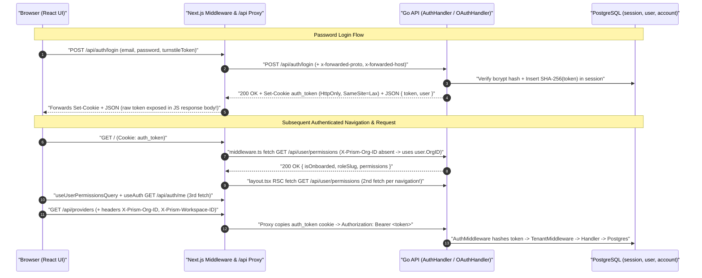
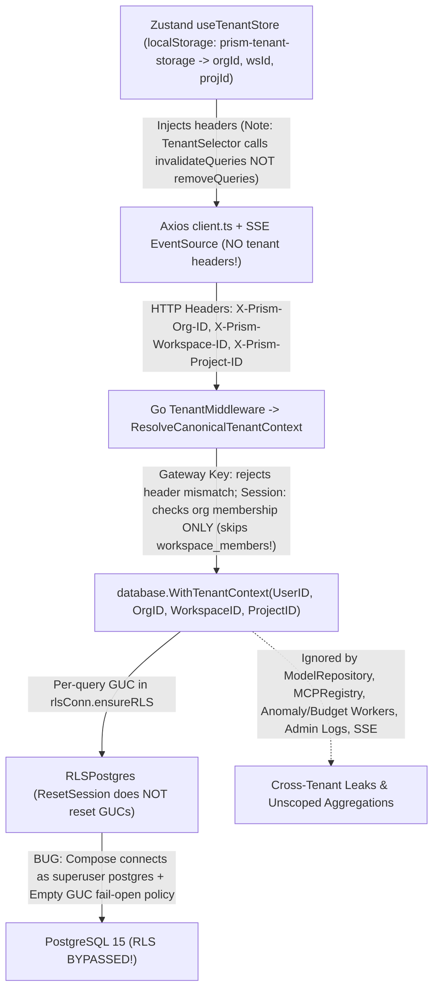

# RoozyLabs Prism — Comprehensive Architecture, Security & Reliability Audit

**Repository:** `https://github.com/roozylabs/prism`  
**Audited Branch & Commit SHA:** `main` @ `e85566b6c5d188a1143cc6d425cd05dc4140c365` (`e85566b`)  
**Audit Date:** 2026-11-21  
**Audit Mode:** Audit-first, read-only code & test verification (zero application code modified)  
**Verdict:** **NOT READY FOR PUBLIC MULTI-TENANT PRODUCTION** (`4 P0`, `17 P1`, `12 P2`, `4 P3` = **37 confirmed findings**)

> [!NOTE]
> **Post-Remediation Addendum (`2026-11-22`):** The historical section below captures the pre-remediation baseline audit (`e85566b`). Remediation items **`REM-01` through `REM-24`** have now been implemented in code and verified by local Go (`go vet`, `go test -race`) and Next.js (`typecheck`, `lint`, `vitest`, `next build`) unit/component suites. See [`prism-remediation-roadmap.md`](./prism-remediation-roadmap.md) and [`prism-readiness-matrix.md`](./prism-readiness-matrix.md) for current task status and the remaining live Docker/CI release gates (PostgreSQL 15 RLS drill, Redis 7, and live Playwright E2E).

---

## 1. Executive Summary

RoozyLabs Prism (`v0.4.0` package metadata; v2.1/v2.2 architecture docs) has received substantial hardening across recent remediation waves (`Wave 1`–`Wave 7`):

- **Verified strengths implemented in current code:**
  - `HttpOnly`, `SameSite=Lax`, proxy-aware `Secure` cookies carry sessions cleanly through Next.js `/api/[[...path]]` (`apps/app/app/api/[[...path]]/route.ts:37-45`) without client-side `Cookies.set()` writes in `AuthContext.tsx`.
  - Session tokens are SHA-256 hashed at rest (`apps/api/internal/repository/session.go`), database queries apply bounded `DB_STATEMENT_TIMEOUT_MS` (`apps/api/internal/database/postgres.go:17-57`) and fail-fast Redis timeouts (`apps/api/internal/database/redis.go:34-52`), and `Config.Validate()` (`apps/api/internal/config/config.go:207-278`) fails closed on weak secrets/datastores/origins outside `APP_ENV=development`.
  - Frontend type hygiene shows zero `: any` occurrences across `apps/app`, `pnpm --filter prism-dashboard lint` passes with `0 errors` (`15` warnings), `typecheck` passes, and 14/14 core management form dialogs/sheets use React Hook Form + Zod + submission locking (`isSubmitting`).
  - `scripts/deploy/test-blue-green.sh` passes 20/20 deployment smoke checks.

However, **critical security, isolation, correctness, and operational blockers remain open on `main`**:

1. **Multi-tenant RLS is dormant at runtime and broken in verification scripts (`AUD-P0-01`):** Production Compose services connect as PostgreSQL superuser `postgres` (`docker-compose.yml:36,127,194,372`), policies fail open when session GUCs are unset (`migrations/111` lines 141-144, `migrations/114` lines 46-49), `rlsConn.ResetSession` does not reset session-level GUCs, 16+ tenant tables have no RLS policies, and both `apps/api/internal/database/rls_role_verification_test.go:92-96` and `scripts/backup/pg-restore-test.sh:71-77` reference non-existent table `users` and non-existent column `organizations.owner_id`.
2. **Global model slug namespace leaks private custom models and causes cross-tenant collisions (`AUD-P0-02`):** `ModelRepository.ListEnabled` and `FindBySlug` (`apps/api/internal/repository/model.go:142-188`) have zero tenant scoping, exposing tenant-private custom models and provider names on `GET /v1/models`, `GET /api/analytics/finops`, and `POST /api/routing/replay`, and enabling cross-tenant `gpt-4o` slug-collision DoS / existence oracle behavior in `Router.ResolveWithFallback`.
3. **OAuth pre-account takeover (`AUD-P0-03`):** `Signup` creates unverified password accounts (`EmailVerified: false`) with no email verification flow, while `CreateOAuthSession` (`apps/api/internal/service/auth.go:202-276`) auto-links solely by email match, sets `EmailVerified = true`, and leaves any pre-registered attacker password credential active.
4. **Raw session bearer token still returned in Login/Signup JSON responses + `?token=` query acceptance (`AUD-P0-04`):** `AuthHandler.Login` and `Signup` (`apps/api/internal/handlers/auth.go:268,324`) return `LoginResponse.Token` in response JSON even though the dashboard now authenticates via `HttpOnly` cookies, and `AuthMiddleware` (`apps/api/internal/middleware/auth.go:33-36`) still accepts `?token=` query parameters on all protected endpoints.
5. **High-impact P1 failures:** Unscoped FinOps background workers (`AUD-P1-07`), cross-tenant MCP Registry leak (`AUD-P1-06`), Google credential OAuth missing org check (`AUD-P1-09`), MCP inbound audit trails 100% failing HMAC verification (`AUD-P1-12`), SDK/CLI routes broken by `PrincipalGatewayKey` rejection in `authz.Can` (`AUD-P1-16`), 1-request -> ~29-invalidation SSE storm + user-only channel cross-org leak (`AUD-P1-04`, `AUD-P1-05`), 3-way broken "All Time" dashboard time window + `INNER JOIN gateway_api_keys` log omission (`AUD-P1-14`, `AUD-P1-15`), frontend cross-org React Query cache retention + `PermissionContext` default `OWNER` fallback (`AUD-P1-13`), and a live `go test -race` failure in `CachedQuotaEvaluator` (`AUD-P1-17`).

---

## 2. Repository Baseline & Test Verification

| Attribute | Observed Value |
|---|---|
| Repository | `https://github.com/roozylabs/prism` (`c:\me\roozylabs\projects\prism`) |
| Default Branch / SHA | `main` @ `e85566b6c5d188a1143cc6d425cd05dc4140c365` |
| Working Tree State | Clean prior to generating the 3 audit docs |
| `AGENTS.md` | Not present at repo root; agent rules live in `.agents/rules/` |
| Local Docker Desktop | **Offline** (`//./pipe/dockerDesktopLinuxEngine` unavailable during audit) |
| Graph Coverage (`codebase-memory-mcp`) | Project `C-me-roozylabs-projects-prism` (`11,395` nodes, `41,360` edges); `parse_partial` on `58` files, `23` ignored files (including migrations/build outputs). Every cited finding was read directly from source. |

### Executed Commands & Actual Outcomes at `e85566b`

| Suite / Command | Result | Scope & Exact Observations |
|---|---|---|
| `go vet ./...` (in `apps/api`) | **PASS** (exit `0`) | Clean across all Go packages |
| `go test -count=1 ./...` (in `apps/api`) | **PASS** (exit `0`) | 17 packages with unit tests passed; 5 packages reported `[no test files]`; live PostgreSQL/Redis integration tests skipped because Docker is offline |
| `go test -race -count=1 ./internal/proxy/... ./internal/handlers/... ./internal/middleware/... ./internal/service/... ./internal/workers/... ./internal/database/...` | **FAIL** (exit `1`) | **`internal/proxy` FAILED:** `TestCachedQuotaEvaluator_ConcurrentMissesShareOneEvaluation` (`quota_cache_test.go:115: concurrent misses should share one evaluation, got 4`). `handlers`, `middleware`, `service`, `workers`, `database` passed `-race`. |
| `pnpm --filter prism-dashboard lint` | **PASS** (exit `0`) | `0` errors, `15` warnings (React Compiler compatibility, exhaustive-deps, aria roles, `window.location.assign`) |
| `pnpm --filter prism-dashboard typecheck` | **PASS** (exit `0`) | Clean `tsc --noEmit` |
| `pnpm --filter prism-dashboard test` | **PASS** (exit `0`) | `17` Vitest files, `59` tests passed (`868s` wall-clock under parallel contention) |
| `pnpm --filter prism-dashboard exec playwright test --list` | **PASS** (exit `0`) | Listed `2` tests in `apps/app/e2e/dashboard.spec.ts`; live execution skipped (`test.skip` without `PLAYWRIGHT_LIVE_E2E=1`) |
| `pnpm --recursive --filter "./packages/*" run build` & `lint` | **PASS** (exit `0`) | `@roozylabs/prism` SDK and `@roozylabs/prism-cli` compiled & typechecked cleanly |
| `bash scripts/deploy/test-blue-green.sh` | **PASS** (exit `0`) | `20/20` blue-green script checks passed |

### Explicitly Unverified Locally
- Live PostgreSQL `testdb` integration tests (`migrations/001`–`114`, `TestRLS*`, SQL query execution plans, and `pg-restore-test.sh`).
- Live Redis pub/sub, Lua rate-limiter/budget scripts, and `queue.JobQueue` integration tests.
- Live Playwright E2E flows against running Next.js + Go API containers.
- Live VPS deployment, TLS termination, Cloudflare Turnstile live challenge, and real OAuth callbacks.
- Python SDK `pytest` (verified only in `.github/workflows/packages-ci.yml`; not executed locally).

---

## 3. Disposition of Prior Audit Findings

Every prior finding from `docs/frontend-architecture-audit.md`, `docs/audit/app-api-cross-system-integrity-audit.md`, `docs/AUTHORIZATION_AUDIT.md`, `docs/audit/system-wide-product-integrity-audit.md`, and `docs/Prism Reliability Audit.md` is classified below against the actual code at `e85566b`:

| Prior ID / Source | Summary | Disposition at `e85566b` | Exact Code Evidence |
|---|---|---|---|
| `S-01` (`frontend-architecture-audit.md`) | Session token stored in JS-readable cookie; Bearer returned in JSON | **Partially fixed** | `AuthContext.tsx` no longer writes `Cookies.set()`, and `/api/[[...path]]/route.ts:42-45` injects `Authorization` from the `HttpOnly` cookie. However, `handlers/auth.go:268,324` still returns `LoginResponse.Token` in JSON, `lib/api/client.ts:16-19,34` retains dead `Cookies.get/remove('auth_token')`, and `middleware/auth.go:33-36` still accepts `?token=`. |
| `S-02` (`frontend-architecture-audit.md`) / `metrics` | Synthetic `0.667/0.333` token split / Cookie security | **Partially fixed** | Synthetic multipliers removed from UI; proxy forwards `x-forwarded-proto` (`route.ts:37-39`). CSRF remains `SameSite=Lax`-only with no CSRF token or `Origin` validation on mutations/logout (`handlers/auth.go:334-362`). |
| `S-03` (`frontend-architecture-audit.md`) | Dashboard date range disconnected | **Fixed and verified** *(partially regressed into 3-way window)* | `useDashboardStatsQuery(dateRange)` and `useUsageChartQuery(dateRange)` now accept `dateRange` (`useDashboardQuery.ts:21,29`), but `"all"` (`All Time`) still queries 3 conflicting windows (`AUD-P1-14`). |
| `S-04` (`frontend-architecture-audit.md`) / `D-04` | SSE checked `Cookies.get('auth_token')`, breaking `HttpOnly`/OAuth SSE | **Fixed and verified** | `SSEContext.tsx:33,46,66` gates on `useAuth().isAuthenticated` and connects with `new EventSource(ApiEndpoints.SSE, { withCredentials: true })`. `POST /api/auth/logout` moved outside `AuthMiddleware` (`auth.go:334-362`). |
| `S-05` (`frontend-architecture-audit.md`) / `PermissionProvider` | Stale tenant cache & `PermissionContext` default `OWNER` | **Still reproducible** | `TenantSelector.tsx:72-88` calls `invalidateQueries()` rather than `removeQueries()`, `22/24` query hooks omit tenant IDs from `queryKey`, and `PermissionProvider.tsx:18-24` still defaults to `UserRole.OWNER` / `() => true`. |
| `S-06` (`frontend-architecture-audit.md`) | Scattered `localStorage` tokens & OAuth redirect hardening | **Partially fixed** | `localStorage` token reads removed and `oauth_state` CSRF cookie added (`auth_oauth.go:24-30`), but `getBaseURL` trusts `X-Forwarded-Host` (`auth_oauth.go:73-97`) and `CreateOAuthSession` allows pre-account takeover (`service/auth.go:202-258`). |
| `A-01`–`A-08` (`frontend-architecture-audit.md`) | Monolithic `lib/api.ts`, query keys, mixed mutations, mock orgs, RHF forms | **Partially fixed** | `lib/api.ts` split into domain modules (`lib/api/*.ts`), `lib/mock-data.ts` deleted, `TenantSelector` wired to APIs, 14/14 core forms use RHF+Zod. However, `hooks/queries/` still declares 12 mutations across 5 files, `26/27` pages are `'use client'`, `0` `loading.tsx` files exist, and `ClientOnboardingModal` + org settings workspace forms bypass RHF/Zod. |
| `T-01`, `T-02` (`frontend-architecture-audit.md`) | TypeScript `any` cleanup; UI model workarounds; tests | **Partially fixed** | Zero `: any` in `apps/app`, `17` Vitest files pass; `Playwright` tests remain `test.skip` by default (`e2e/dashboard.spec.ts:6`). |
| `U-01`–`U-04` (`frontend-architecture-audit.md`) | Error states, loading skeletons, confirm dialogs | **Partially fixed** | `ConfirmDialog` & `ErrorState` widely adopted; `TenantSelector` still hides Workspace (`hidden lg:inline-flex`) and Project (`hidden xl:inline-flex`) selectors on smaller screens (`TenantSelector.tsx:149,184`). |
| `D-01`–`D-08` (`app-api-cross-system-integrity-audit.md`) | Credential swap, custom provider, invite loop, MCP/Tool/Agent wipes, Policy weights | **Partially fixed / Mostly fixed** | `D-01`–`D-07` UI/handler contracts largely remediated across Waves 1–6; `D-08` ("All Time" dashboard) and `D-12` (Billing flag stub `{ planId }` vs `{ planSlug }` at `lib/api/billing.ts:19-21` vs `handlers/billing.go:37-51`) remain **Still reproducible**. |
| `D-09` (`app-api-cross-system-integrity-audit.md`) | Proxy path traversal, missing abort signal, middleware bypass | **Fixed and verified** *(minor middleware catch loop remains)* | Both proxies use `sanitizeProxyPath` + `signal: request.signal` + `redirect: 'manual'` (`api/[[...path]]/route.ts:18-64`, `v1/[[...path]]/route.ts:50`); `x-next-data` bypass removed, though `middleware.ts:90-95` `catch` loop remains (`AUD-P1-02`). |
| `D-10` (`app-api-cross-system-integrity-audit.md`) | Dormant RLS & `user_id`-only tenant scoping | **Partially fixed** | Migration `111`, `database/rls_driver.go`, and `repository/tenant_scope.go` were added, **but** production still connects as superuser `postgres`, empty-GUC policies fail open, `ModelRepository`, `MCPRegistryRepository`, background FinOps workers, `GoogleOAuthHandler`, and `GetAgentStats` still leak cross-org (`AUD-P0-01`, `AUD-P0-02`, `AUD-P1-06`–`AUD-P1-13`). |
| `D-14` (`app-api-cross-system-integrity-audit.md`) | Gateway API key compatibility with SDK/CLI | **Regressed** | `RequirePermission` (`middleware/rbac.go:37-40`) classifies gateway keys as `PrincipalGatewayKey`, which `authz.Can` (`authz/engine.go:101`) denies (`len(perms)==0` and not `PrincipalHumanUser`), breaking all 20 routes in `GatewayKeyRoutes` + Paperclip register (`AUD-P1-16`). |
| `SEC-001`–`SEC-008` (`AUTHORIZATION_AUDIT.md`) | Fail-open RBAC, `org_default`, `user_admin`, missing RBAC, `workspace_members` | **Partially fixed** | `user_admin` removed (`migration 111`), `authz.AuthorizationEngine` fails closed on nil/error, last-owner guard exists. However, `6` tenant routes omit `RequirePermission` (`main.go:481-491,607`), `TenantMiddleware` does not check `workspace_members`, and `QuotaHandler` allows bypassing workspace membership when workspace header is omitted (`AUD-P1-08`). |
| `Reliability Audit` + `Wave 7` (`P2-1`–`P2-4`, `P3-1`) | Blue-green isolation, drain, OTel, backup restore drill, quota cache | **Partially fixed** | Blue-green script passes (`20/20`), OTel & worker `WaitGroup` drain wired (`main.go:650-671`), `AuditRecorder` uses keyed HMAC (`audit_recorder.go:186-188`). However, `rls_role_verification_test.go` & `pg-restore-test.sh` fail on nonexistent `users`/`organizations.owner_id` (`AUD-P0-01`), `recordMCPAudit` breaks HMAC (`AUD-P1-12`), and `CachedQuotaEvaluator` failed `-race` (`AUD-P1-17`). |

---

## 4. Architecture & Frontend-to-Backend Request Flow

Prism comprises a Go 1.25 Gin API server (`apps/api`, `186` route registrations in `apps/api/cmd/server/main.go`), a Next.js 16 App Router console (`apps/app`, `27` page routes), an Astro marketing site (`apps/web`, excluded from app edits), and TypeScript/Python SDKs (`packages/sdk`, `packages/cli`, `packages/python-sdk`).

```mermaid
flowchart LR
  Browser["Browser (Next.js Console + EventSource)"] -->|"Cookies: auth_token (HttpOnly) + Headers: X-Prism-Org-ID / Workspace / Project"| NextMW["Next.js middleware.ts (Onboarding + Session Check)"]
  NextMW -->|"Page Requests"| DashboardLayout["RSC app/(dashboard)/layout.tsx (getServerUserPermissions)"]
  DashboardLayout -->|"26 of 27 pages use client hooks"| ClientPages["Client Pages + TanStack React Query"]
  ClientPages -->|"Axios /api/* & SSE withCredentials"| ApiProxy["Next.js Route /api/[[...path]]"]
  ClientPages -->|"Sandbox fetch /v1/*"| V1Proxy["Next.js Route /v1/[[...path]]"]
  SDK["CLI / TS SDK / External Agents (Bearer prism_sk_*)"] -->|"Direct HTTP"| Nginx["Nginx / Load Balancer"]
  ApiProxy -->|"Injects Authorization Bearer from HttpOnly Cookie + x-forwarded-proto"| GinRouter["Go Gin Engine (main.go: 186 routes)"]
  V1Proxy --> GinRouter
  Nginx --> GinRouter
  GinRouter -->|"AuthMiddleware -> TenantMiddleware -> RestrictGatewayKeys -> RequirePermission"| Handlers["Go Handlers (internal/handlers)"]
  Handlers -->|"ContextWithTenant -> TenantDBContext"| Repos["SQL Repositories (internal/repository)"]
  Repos -->|"OpenRLSPostgres set_config GUCs"| Postgres["PostgreSQL 15 (Connected as Superuser postgres!)"]
  Handlers -->|"Cooldown, Pub/Sub, Rate Limit, Budget Lua"| Redis["Redis 7"]
```

---

## 5. Authentication & Session Security (P0 / P1)

### Current Authentication Sequence

### Cookie & Session Security Verification

| Attribute | Observed Implementation | Verification / Gap |
|---|---|---|
| `HttpOnly` | `true` on `Login`, `Signup`, `Logout`, `OAuthCallback` (`auth.go:266,322,359`) | **Verified**, but `LoginResponse.Token` still exposes raw token in JSON (`AUD-P0-04`) |
| `Secure` | `c.Request.TLS != nil \|\| X-Forwarded-Proto == "https"` (`auth.go:265`), forwarded by `/api` proxy (`route.ts:37-39`) | **Verified** behind HTTPS proxy; fails HTTP if proxy terminates TLS without `X-Forwarded-Proto` |
| `SameSite` | `http.SameSiteLaxMode` (`auth.go:264`) | Set, but insufficient alone against sibling-subdomain CSRF and state-changing GET/logout (`AUD-P1-01`) |
| `Domain` & `Path` | Domain `""` (host-only), Path `"/"` (`auth.go:266,359`) | Host-only cookie; safe unless sibling subdomains run untrusted apps under SameSite=Lax |
| Expiration / `Max-Age` | `7 * 24 * 3600` seconds (`auth.go:266`), matching DB `ExpiresAt` (`service/auth.go:120`) | No sliding expiration or token rotation (`AUD-P2-01`) |
| Cookie Clearing | `POST /api/auth/logout` is outside `AuthMiddleware` (`main.go`) and sets `Max-Age=-1` (`auth.go:359`) | Clears stale `HttpOnly` cookie reliably, but unauthenticated route enables logout CSRF (`AUD-P1-01`) |
| CSRF Protection | No CSRF token, no `Origin`/`Sec-Fetch-Site` check on mutations or logout | Confirmed gap (`AUD-P1-01`) |
| Cross-Origin Credentials | `AllowCredentials: true`, production blocks `*` & local origins (`config.go:258-278`) | `CORSMiddleware` `AllowHeaders` (`cors.go:27`) omits tenant/routing headers (`AUD-P1-03`) |

---

### Findings — Authentication & Session Security

#### AUD-P0-03 — OAuth Pre-Account Takeover via Unverified Password Signup + Auto-Link by Email
- **Finding ID:** `AUD-P0-03`
- **Severity:** `P0`
- **Domain:** Authentication & OAuth Account Linking
- **Exact File Path:** `apps/api/internal/service/auth.go`, `apps/api/internal/handlers/auth_oauth.go`
- **Relevant Line Numbers / Code References:** `service/auth.go:155-169,202-276`, `auth_oauth.go:227-236`
- **Current Implementation:** `AuthService.Signup` creates a password credential account with `EmailVerified: false` and has no email verification flow. `AuthService.CreateOAuthSession` looks up users solely via `s.users.FindByEmail(ctx, email)` (`:210`), silently sets `user.EmailVerified = true` (`:246`), links a new `account` row with `ProviderID: provider`, and issues a valid session while leaving the existing `provider_id = 'credential'` password intact. Every OAuth login also calls `s.accounts.Create` with a fresh UUID (`:251-258`) instead of checking for an existing `(user_id, provider_id)` link.
- **Why It Is Problematic:** An attacker who pre-registers a victim's email address via `/api/auth/signup` with a known password retains permanent password-login access even after the victim later signs in via Google or GitHub OAuth and assumes OAuth owns the account. Repeated OAuth logins also insert duplicate `account` rows if no unique constraint blocks them.
- **Reproduction Scenario:** 1) Attacker calls `POST /api/auth/signup` for `victim@acme.com` with attacker password `P1`. 2) Victim clicks "Continue with Google" for `victim@acme.com`. 3) `CreateOAuthSession` finds the dormant row, sets `EmailVerified = true`, creates a `google` `account` row, and logs victim into the organization. 4) Attacker calls `POST /api/auth/login` with `(victim@acme.com, P1)` and retains full session access to the victim's org.
- **Actual or Potential Impact:** Confirmed account-takeover vector (`pre-account takeover`) giving an attacker persistent access to a victim's workspace, API keys, and upstream LLM credentials.
- **Recommended Remediation:** Refuse auto-linking password accounts whose `EmailVerified == false` inside `CreateOAuthSession` unless explicitly confirmed after re-authentication (or require email verification on signup and quarantine/reset unverified credential accounts before OAuth claims them); upsert `account` keyed by `(provider_id, account_id)` instead of inserting on every OAuth login.
- **Required Regression Tests:** Go unit/integration test asserting OAuth sign-in against an unverified `credential` account cannot leave the attacker password active, plus idempotent repeated OAuth login not duplicating `account` rows.
- **Confidence:** `High` *(Confirmed Bug)*

#### AUD-P0-04 — Backend Login/Signup Still Returns Raw Session Token in JSON + `?token=` Query Auth Still Active
- **Finding ID:** `AUD-P0-04`
- **Severity:** `P0`
- **Domain:** Authentication & Session Token Exposure
- **Exact File Path:** `apps/api/internal/handlers/auth.go`, `apps/api/internal/service/auth.go`, `apps/api/internal/middleware/auth.go`, `apps/app/lib/api/client.ts`
- **Relevant Line Numbers / Code References:** `handlers/auth.go:268,324`, `service/auth.go:90-93`, `middleware/auth.go:33-36`, `lib/api/client.ts:16-19,34`
- **Current Implementation:** Despite `AuthHandler.Login` (`:266`) and `Signup` (`:322`) setting an `HttpOnly` `auth_token` cookie (and `AuthContext.tsx` no longer storing tokens in JS), both handlers return `c.JSON(..., resp)` where `service.LoginResponse` serializes `Token string` (`json:"token"`). Simultaneously, `AuthMiddleware` (`middleware/auth.go:33-36`) accepts `token = c.Query("token")` on **all** protected endpoints, and `apps/app/lib/api/client.ts:16-19,34` retains dead `Cookies.get('auth_token')` / `Cookies.remove('auth_token')` calls.
- **Why It Is Problematic:** Any XSS vulnerability, third-party script, or response-logging proxy captures a 7-day bearer session token directly from the `/api/auth/login` or `/api/auth/signup` response body, defeating `HttpOnly` protection. Accepting `?token=` across all routes risks leaking session tokens and gateway keys into nginx/CDN access logs and `Referer` headers.
- **Reproduction Scenario:** Open DevTools Network tab on `/signin`, submit credentials, and inspect the `/api/auth/login` JSON response: `"token": "<64-char-sha256>"` is readable by any JS script on the origin. Replaying `?token=<value>` on any `/api/*` endpoint succeeds (`middleware/auth.go:34-36`).
- **Actual or Potential Impact:** Complete bypass of `HttpOnly` cookie session confidentiality under any client script compromise, plus credential leakage into HTTP access logs.
- **Recommended Remediation:** Omit `token` from browser JSON responses (or gate bearer-token return behind an explicit non-browser header / CLI flow), remove `token` field from `LoginResponse` used by browser login/signup, remove dead `js-cookie` token handling from `client.ts` & `AuthContext.tsx`, and restrict `c.Query("token")` removal from `AuthMiddleware` (SSE already uses `HttpOnly` cookies via `withCredentials: true`).
- **Required Regression Tests:** Handler test asserting `/api/auth/login` and `/api/auth/signup` response JSON excludes raw session `token` for browser sessions; middleware test asserting `?token=` returns `401` on `/api/*` routes.
- **Confidence:** `High` *(Confirmed Bug)*

#### AUD-P1-01 — Missing CSRF Defense-in-Depth on Cookie-Authenticated Mutations & Unauthenticated Logout
- **Finding ID:** `AUD-P1-01`
- **Severity:** `P1`
- **Domain:** Cookie & Session Security (CSRF)
- **Exact File Path:** `apps/api/internal/handlers/auth.go`, `apps/api/cmd/server/main.go`, `apps/app/app/api/[[...path]]/route.ts`
- **Relevant Line Numbers / Code References:** `handlers/auth.go:264-266,320-322,334-362`
- **Current Implementation:** Cookie-authenticated endpoints rely solely on `SameSite=Lax`. No CSRF synchronizer token, double-submit token, or `Origin`/`Referer`/`Sec-Fetch-Site` validation middleware is enforced on state-changing requests (`POST`/`PUT`/`PATCH`/`DELETE`), and `POST /api/auth/logout` clears the cookie without verifying origin.
- **Why It Is Problematic:** `SameSite=Lax` treats sibling subdomains (e.g., compromised docs/blog/preview subdomains under `*.roozylabs.com`) as **same-site**, allowing cross-origin form/fetch POSTs to inherit the `auth_token` cookie and execute admin actions (creating gateway keys, adding members, changing routing policies).
- **Reproduction Scenario:** A page on `attacker.roozylabs.com` submits a form or fetch with credentials to `POST https://app.prism.roozylabs.com/api/gateway-keys` or `POST /api/auth/logout`; the browser attaches the `HttpOnly` `auth_token` cookie under `SameSite=Lax` and executes without CSRF challenge.
- **Actual or Potential Impact:** Cross-subdomain request forgery of privileged mutations and forced logout DoS.
- **Recommended Remediation:** Enforce strict `Origin` (and `Sec-Fetch-Site` when present) matching against `Config.AllowedOrigins` for all cookie-authenticated non-idempotent requests (or double-submit CSRF header verified at the Go API boundary).
- **Required Regression Tests:** Middleware test sending cookie-authenticated `POST` with mismatched `Origin` / `Sec-Fetch-Site: cross-site` verifying `403 CSRF_REJECTED`.
- **Confidence:** `High` *(Confirmed Architectural/Config Risk)*

#### AUD-P1-02 — `middleware.ts` Transient Network Error Redirect Loop on Auth Pages
- **Finding ID:** `AUD-P1-02`
- **Severity:** `P1`
- **Domain:** Authentication & SSR Session Handling
- **Exact File Path:** `apps/app/middleware.ts`
- **Relevant Line Numbers / Code References:** `middleware.ts:90-95`
- **Current Implementation:** When an `auth_token` cookie is present and the SSR `fetch('${backendUrl}/api/user/permissions')` throws a network error (`ECONNREFUSED`, timeout during deploy/restart), the `catch` block executes `if (token && isAuthPage) return NextResponse.redirect(new URL('/', request.url))`.
- **Why It Is Problematic:** During a brief API restart when a user also has an expired cookie on `/signin` (or is sent to `/signin` by client-side `401`), SSR middleware bounces them back to `/`, where dashboard queries fail and redirect back to `/signin`, triggering an infinite browser redirect loop.
- **Reproduction Scenario:** Visit `/signin` with any non-empty `auth_token` cookie while `API_URL` is temporarily unreachable (`fetch` throws). `middleware.ts:92` immediately redirects `GET /signin` -> `/`.
- **Actual or Potential Impact:** Total UI lockout during API blips or container rollouts whenever users visit `/signin` or `/signup` with a lingering cookie.
- **Recommended Remediation:** On network error (`catch`), do NOT redirect `isAuthPage` to `/`; allow `/signin` and `/signup` to render cleanly, and add a short `AbortSignal.timeout(3000)` on the SSR middleware fetch.
- **Required Regression Tests:** Vitest test in `apps/app/middleware.test.ts` mocking a rejected `fetch` on `/signin` with an `auth_token` cookie and asserting `NextResponse.next()` (status `200`), not redirect.
- **Confidence:** `High` *(Confirmed Bug)*

#### AUD-P1-03 — OAuth `getBaseURL` Env Variable Mismatch (`BETTER_AUTH_URL`/`PUBLIC_URL` vs `APP_PUBLIC_URL`) + Untrusted Host Fallback; CORS Header Omissions
- **Finding ID:** `AUD-P1-03`
- **Severity:** `P1`
- **Domain:** OAuth & Cross-Origin Configuration
- **Exact File Path:** `apps/api/internal/handlers/auth_oauth.go`, `apps/api/internal/handlers/oauth_handler.go`, `apps/api/internal/middleware/cors.go`, `docker-compose.yml`
- **Relevant Line Numbers / Code References:** `auth_oauth.go:73-97`, `cors.go:27`, `docker-compose.yml:62`
- **Current Implementation:** `OAuthHandler.getBaseURL` reads `BETTER_AUTH_URL` or `PUBLIC_URL`, neither of which is passed to the `api` container in `docker-compose.yml` (which instead sets `APP_PUBLIC_URL`). When unset, it falls back to `c.GetHeader("X-Forwarded-Host")` and `c.Request.Host`. Separately, `CORSMiddleware` (`cors.go:27`) omits `X-Prism-Org-ID`, `X-Prism-Workspace-ID`, `X-Prism-Project-ID`, `X-Routing-Policy`, `X-Prism-Approval-ID`, and `Idempotency-Key` from `AllowHeaders`.
- **Why It Is Problematic:** In production Docker deployments where `BETTER_AUTH_URL` / `PUBLIC_URL` are absent on the `api` service, any direct request with a spoofed `Host` / `X-Forwarded-Host` manipulates the generated OAuth `redirect_uri`. Direct cross-origin browser requests using `api.prism.roozylabs.com` with tenant headers fail CORS preflight.
- **Reproduction Scenario:** 1) Deploy using `docker-compose.yml` without `PUBLIC_URL` set on `api`; send `X-Forwarded-Host: evil.example` on `/api/auth/oauth/google`. 2) Send a browser preflight `OPTIONS` request to `https://api.prism.roozylabs.com/api/providers` with `Access-Control-Request-Headers: X-Prism-Org-ID`; preflight omits `X-Prism-Org-ID` from allowed headers.
- **Actual or Potential Impact:** Host-header OAuth redirect URI poisoning risk when directly reachable and broken direct cross-origin CORS preflights for tenant-scoped requests.
- **Recommended Remediation:** Standardize `OAuthHandler` and `GoogleOAuthHandler` to prefer `Config.AppPublicURL` (`APP_PUBLIC_URL`) in production rather than request host headers, and add all `X-Prism-*`, `X-Routing-Policy`, and `Idempotency-Key` headers to `CORSMiddleware` `AllowHeaders`.
- **Required Regression Tests:** Unit tests verifying `getBaseURL` uses `APP_PUBLIC_URL` regardless of `X-Forwarded-Host`, and CORS preflight test confirming `200`/`204` for `Access-Control-Request-Headers: X-Prism-Org-ID, X-Prism-Workspace-ID, Idempotency-Key`.
- **Confidence:** `High` *(Confirmed Bug)*

#### AUD-P2-01 — Missing Session Lifecycle Controls (No Token Rotation, Password Change, Revoke-All Sessions, or Concurrency Cap)
- **Finding ID:** `AUD-P2-01`
- **Severity:** `P2`
- **Domain:** Session Lifecycle Management
- **Exact File Path:** `apps/api/internal/service/auth.go`, `apps/api/internal/repository/session.go`
- **Relevant Line Numbers / Code References:** `service/auth.go:117-130,278-289`, `apps/api/cmd/server/main.go`
- **Current Implementation:** Sessions have a fixed 7-day `ExpiresAt`, zero token rotation or sliding renewal, no password-change endpoint, no "revoke all sessions" (`DELETE FROM session WHERE user_id = $1`), and no per-user active session limit or session list UI.
- **Why It Is Problematic:** Compromised sessions remain valid until 7-day expiry with no self-service password rotation or global session revocation mechanism.
- **Reproduction Scenario:** A user whose laptop is lost has no mechanism in Prism Console or `/api/auth/*` to revoke other active sessions or rotate their password.
- **Actual or Potential Impact:** Extended exposure window after device/session compromise and inability to enforce credential hygiene.
- **Recommended Remediation:** Add `DeleteAllForUser(ctx, userID)` in `SessionRepository`, implement `/api/auth/password` + `/api/auth/sessions` management endpoints (invalidating all other sessions on password change/compromise), and prune expired sessions via `RetentionWorker`.
- **Required Regression Tests:** Service/handler tests confirming password change invalidates prior session tokens and `RevokeAllSessions` returns `401` on all other session tokens.
- **Confidence:** `High` *(Confirmed Gap)*

---

## 6. SSE & Real-Time Reliability (P1 / P2)

### SSE Lifecycle (Current vs Proposed)

```mermaid
flowchart TD
  subgraph Current["Current SSE Flow (Confirmed Bugs AUD-P1-04 & AUD-P1-05)"]
    C_Pub["Backend Publishers (21 calls, 17+ event types) -> channel gateway:events:user:{userID}"]
    C_SSE["SSEHandler.Stream -> emits ALL events as event: message"]
    C_Client["SSEContext.tsx (EventSource withCredentials:true) -> No Last-Event-ID"]
    C_Else["else if (eventType === 'message') catches 12+ unmatched event types"]
    C_Storm["Invalidates 6 queries/event -> ~29 React Query refetches per 1 LLM request!"]
    C_Pub --> C_SSE --> C_Client --> C_Else --> C_Storm
  end

  subgraph Proposed["Proposed Target SSE Flow"]
    P_Pub["Org + User Scoped Channels: gateway:events:org:{orgID} (+ Replay ZSET id)"]
    P_SSE["Typed SSE Frames: id: <seq>, event: <eventType>, data: <json>"]
    P_Client["SSEContext typed addEventListener + 250ms debounce queue + filter by active orgId"]
    P_Pub --> P_SSE --> P_Client
  end
```

*(Note: Prior finding `D-04` / `S-04` checking `Cookies.get('auth_token')` before opening `EventSource` is **Fixed and verified** in `apps/app/context/SSEContext.tsx:33,46,66`.)*

---

### Findings — SSE & Real-Time Reliability

#### AUD-P1-04 — SSE Invalidation Storm (`~29` Query Invalidations per LLM Request) + Dropped Domain Invalidations
- **Finding ID:** `AUD-P1-04`
- **Severity:** `P1`
- **Domain:** SSE & Real-Time Reliability
- **Exact File Path:** `apps/app/context/SSEContext.tsx`, `apps/api/internal/handlers/sse.go`
- **Relevant Line Numbers / Code References:** `SSEContext.tsx:93-118`, `sse.go:101`
- **Current Implementation:** `SSEHandler.Stream` (`sse.go:101`) emits every Redis Pub/Sub payload using `event: message`. On the frontend, `SSEContext.tsx:93-110` matches only 5 event names (`CREDENTIAL_STATUS_CHANGED`, `CREDENTIAL_QUARANTINED`, `CREDENTIAL_QUOTA_UPDATED`, `request_log_created`, `active_streams_update`) and falls through to `else if (eventType === 'message')`, which synchronously invalidates **6 heavy queries** (`dashboard-stats`, `dashboard-usage-chart`, `dashboard-health`, `active-streams`, `request-logs`, `credentials`) with zero debouncing or throttling. Meanwhile, backend publishers emit 17+ distinct event types (`ROUTING_DECISION`, `REQUEST_COMPLETED`, `NEW_REQUEST_LOG`, `KEY_USED`, `APPROVAL_REQUIRED`, `CREDENTIAL_COOLDOWN_STARTED`, `budget_alert`, `cost_anomaly`, `TOOL_EXECUTED`, `RESOURCE_EXECUTED`, `async_job_updated`, etc.) and never invalidate `['approvals']`, `['budgets']`, `['budget-alerts']`, or `['finops-anomalies']`.
- **Why It Is Problematic:** A single LLM gateway request emits up to 7 Redis events (each missing the frontend's 5 exact string matches, triggering 6 invalidations each for mismatched types = ~29 invalidations per request), saturating the browser event loop, React Query, `/api` proxy, and PostgreSQL dashboard aggregations under modest traffic, while Approvals and FinOps Alerts pages stay stale.
- **Reproduction Scenario:** Open Dashboard Overview (`/`) with DevTools Network open, send one `POST /v1/chat/completions` request, and observe bursts of duplicate `GET /api/dashboard/stats`, `/usage`, `/health`, `/active-streams`, `/logs`, and `/credentials` requests firing immediately.
- **Actual or Potential Impact:** Self-inflicted DDoS / request storm against dashboard endpoints and PostgreSQL under active agent traffic, plus missing live updates for approvals and budget alerts.
- **Recommended Remediation:** Map each backend `eventType` cleanly in a lookup table in `SSEContext.tsx`, coalesce query invalidations per key with a `250ms–500ms` leading/trailing debounce queue, emit typed SSE `event: <type>` (or match `data.type` consistently), and add invalidations for `approvals`, `budget-alerts`, and `finops-anomalies`.
- **Required Regression Tests:** Vitest tests in `SSEContext.test.tsx` firing bursts of 10 `ROUTING_DECISION`/`NEW_REQUEST_LOG`/`APPROVAL_REQUIRED` events within 50ms and asserting coalesced, targeted invalidations rather than blanket 6-query cascades.
- **Confidence:** `High` *(Confirmed Bug)*

#### AUD-P1-05 — User-Only Redis Pub/Sub Channel Leaks Events Across Organizations & Hides Teammate Activity
- **Finding ID:** `AUD-P1-05`
- **Severity:** `P1`
- **Domain:** SSE & Multi-Tenant Event Isolation
- **Exact File Path:** `apps/api/internal/redis/events.go`, `apps/api/internal/handlers/sse.go`, `apps/api/internal/workers/anomaly.go`, `apps/api/internal/workers/budget_alerts.go`, `apps/api/internal/proxy/engine.go`, `apps/api/internal/queue/job_queue.go`
- **Relevant Line Numbers / Code References:** `events.go:15,23,41-65`, `sse.go:43,68`, `anomaly.go:90`, `budget_alerts.go:67`
- **Current Implementation:** `EventPublisher` keys channels strictly by user (`gateway:events:user:{userID}`), and `SSEHandler.Stream` subscribes solely to `userID` (`sse.go:68`) without checking `organization_id` or attaching `orgId` to `Event` payloads (`events.go:26-30`).
- **Why It Is Problematic:** First, a user belonging to Org A and Org B receives Org B's live events (including full `async_job_updated` result payloads and gateway logs) while actively viewing Org A in the UI — corrupting active React Query caches and cross-pollinating org state. Second, teammates in Org A cannot see live gateway requests, cooldowns, or approvals triggered by keys/agents owned by another member of the same organization.
- **Reproduction Scenario:** User belongs to Org A and Org B. User switches dashboard to Org A (`X-Prism-Org-ID: org_a`). An Org B gateway key sends traffic under the same `userID`; SSE delivers Org B's `async_job_updated` and invalidates Org A's dashboard caches. Meanwhile, Admin B in Org A sees zero live SSE events from keys created by Developer A.
- **Actual or Potential Impact:** Cross-organization UI/cache contamination and broken real-time collaboration for teams.
- **Recommended Remediation:** Include `OrgID` in Redis event envelopes, publish org-scoped events to `gateway:events:org:{orgID}` (and keep user-personal events separate), verify org membership on SSE handshake in `SSEHandler.Stream`, and drop/filter any event not matching the stream's active org.
- **Required Regression Tests:** Handler/SSE test verifying a stream opened under `org_a` rejects/does not receive events published for `org_b`, while receiving `org_a` events triggered by another org member.
- **Confidence:** `High` *(Confirmed Bug)*

#### AUD-P2-02 — SSE Missing `Last-Event-ID` Replay & Blocking `time.Sleep` Reconnect Ignore Shutdown/Disconnect
- **Finding ID:** `AUD-P2-02`
- **Severity:** `P2`
- **Domain:** SSE Reliability
- **Exact File Path:** `apps/api/internal/handlers/sse.go`
- **Relevant Line Numbers / Code References:** `sse.go:75-106`
- **Current Implementation:** Events carry no monotonic `id:` field and no short-TTL Redis Stream/ZSET replay buffer; any event emitted during a network blip or blue-green cutover is permanently lost. Additionally, line 92 executes an uninterruptible `time.Sleep(1 * time.Second)` on Redis channel close instead of selecting on `c.Request.Context().Done()` and `h.closing`.
- **Why It Is Problematic:** During blue-green deployment cutovers or brief mobile disconnects, pending approvals or async job completions are missed permanently, forcing manual page reloads; blocking sleep delays SSE handler exit by up to 1s during graceful shutdown.
- **Reproduction Scenario:** Disconnect client briefly while an async sandbox job completes; reconnect via EventSource — no missed event is replayed.
- **Actual or Potential Impact:** Lost real-time job/approval notifications during brief network drops or deployments.
- **Recommended Remediation:** Add a 5-minute Redis Stream/ring-buffer keyed by `orgID` emitting SSE `id:` frames with `Last-Event-ID` catch-up on reconnect, and replace `time.Sleep` with `select { case <-ctx.Done(): case <-h.closing: case <-time.After(...): }`.
- **Required Regression Tests:** `sse_test.go` test closing SSE stream during shutdown (`h.Shutdown()`) while Redis disconnects, plus replay test on reconnect with `Last-Event-ID`.
- **Confidence:** `High` *(Confirmed Architectural/Config Risk)*

---

## 7. Tenant & Workspace Isolation (P0 / P1)

### Tenant Context Propagation Diagram

### Direct Answers to Mandatory Investigation Questions (Section 4)

1. **Can one tenant access another tenant's resources by manipulating IDs?**
   - **Organization-level:** Most org-scoped single-item handlers (`Provider`, `Credential`, `GatewayKey`, `Budget`, `Agent`, `Tool`, `Resource`, `MCPServer`, `GovernancePolicy`) enforce `tenantOwnerClause(ctx, ...)`. **However**, serious cross-tenant gaps exist via: (a) **global `ModelRepository.FindBySlug` & `ListEnabled`** (`AUD-P0-02`), allowing slug collision and model discovery across orgs; (b) **unscoped `GoogleOAuthHandler` `providerAcceptsCredentialsFrom`** omitting `orgID` (`AUD-P1-09`); (c) **empty/NULL `org_id` fallback in `GetAgentStats` / `GetAgentTotalSpendUSD`** with no `user_id` check (`AUD-P1-10`); and (d) **Redis active-stream `GetActiveStreams(ctx, "")` cross-tenant delete-DoS** (`AUD-P1-11`).
   - **Workspace/Project-level (within the same organization):** **Yes.** Almost all single-item CRUD handlers and gateway execution paths (`GET/PUT/DELETE` for agents, tools, resources, MCP servers, budgets, governance policies, gateway keys, `/v1/approvals/:approvalId`, `/api/jobs/:jobId`) ignore `X-Prism-Workspace-ID` / `X-Prism-Project-ID` and never verify `workspace_members` (`AUD-P1-08`).
2. **Can stale frontend cache expose previously selected tenant data?**
   - **Yes.** Because `22/24` React Query hooks omit `selectedOrgId`, `selectedWorkspaceId`, and `selectedProjectId` from `queryKey`, switching orgs renders stale cached Org A data for inactive routes until background refetches finish (`AUD-P1-13`).
3. **Does switching organizations invalidate all tenant-dependent queries?**
   - `TenantSelector.tsx:72-88` calls `queryClient.invalidateQueries()` (preserving stale data in memory rather than `removeQueries`/`resetQueries` and not canceling in-flight requests from the previous org, `AUD-P1-13`). Workspace and Project dropdowns are also hidden below `lg`/`xl` viewports (`AUD-P3-02`).
4. **Are backend queries consistently scoped to the authenticated organization?**
   - **No.** Confirmed unscoped or fallback-leaky code paths exist in `ModelRepository`, `MCPRegistryRepository`, `workers/anomaly.go` + `CostAnomalyRepository`, `workers/budget_alerts.go` + `BudgetRepository.GetCombinedSpend`, `RequestLogRepository.GetAgentStats`/`GetAgentTotalSpendUSD`, `PilotOutcomesRepository`, `MCPServerHandler.recordMCPAudit`, `ProviderHealthStore`, Redis telemetry keys, and `EventPublisher` (`AUD-P0-02`, `AUD-P1-05`–`AUD-P1-12`).
5. **Are authorization checks enforced on the backend rather than relying on UI permissions?**
   - **Mostly yes on core routes, but incomplete:** `RequirePermission` covers ~170 dashboard routes (`cmd/server/main.go`), while UI `PermissionGuard` is unused (`0` consumers) and `PermissionProvider.tsx:18-24` defaults to `OWNER` / `() => true`. **Critically**, 6 tenant-scoped backend routes lack `RequirePermission` (`/dashboard/stats`, `/dashboard/usage`, `/dashboard/health`, `/dashboard/active-streams`, `/sse`, `/jobs/:jobId`), and `TenantMiddleware` checks `FindWorkspaceInOrg` rather than `workspace_members` (`AUD-P1-08`).
6. **Can a resource be accessed through an alternate endpoint that lacks tenant validation?**
   - **Yes:** `GET /v1/models` & `POST /api/routing/replay` expose cross-tenant `ModelRepository.ListEnabled` (`AUD-P0-02`); `GET /v1/approvals/:approvalId` allows cross-workspace read within an org (`AUD-P1-08`); `GET /api/mcp/registry` & `GET /api/mcp/registry/:slug` expose private multi-org servers via `user_id` (`AUD-P1-06`); `/api/audit-trail/logs` falls back on `user_id` when `org_id` is absent or via `PilotOutcomesRepository` `NULL` fallback (`AUD-P1-10`).

### Complete Tenant-Isolation Matrix (24 Domains)

| Domain | Org Isolation | Workspace / Project Isolation | RLS Enforced (Runtime) | Known Bypass / Finding ID |
|---|---|---|---|---|
| **1. Organizations & Members** | `IsMember` / RBAC enforced | N/A | None (`user`/members use app SQL) | Missing sibling subdomain CSRF protection (`AUD-P1-01`) |
| **2. Workspaces** | Scoped by `org_id` | No `workspace_members` check in `TenantMiddleware` | `No` (excluded from RLS) | Any org member can target any workspace if header known (`AUD-P1-08`) |
| **3. Projects** | Scoped via `workspaces.org_id` | Checked against parent workspace only (`hierarchy.go`) | `No` | Missing `project_members` / workspace-member check (`AUD-P1-08`) |
| **4. Providers** | `tenantOwnerClause` (`org_id` + `user_id` fallback) | Ignored on single-item CRUD | Bypassed (`postgres` superuser) | System providers visible to all; `OR (org_id IS NULL AND user_id=$)` fallback (`AUD-P0-01`, `AUD-P1-10`) |
| **5. Models Catalog** | **NONE** (Global query by slug/enabled) | **NONE** | `No` (excluded from RLS) | Cross-tenant private model disclosure, `gpt-4o` collision DoS (`AUD-P0-02`) |
| **6. Credentials** | `tenantOwnerClause` | Ignored | Bypassed (`postgres` superuser) | Google OAuth omits `orgID` (`AUD-P1-09`); delete scan causes cross-tenant DoS (`AUD-P1-11`) |
| **7. Gateway API Keys** | `tenantOwnerClause` + key-pinned `OrgID` | Pinned at gateway runtime; CRUD ignores workspace check | Bypassed (`postgres` superuser) | SDK/CLI gateway key calls fail `RequirePermission` (`AUD-P1-16`) |
| **8. Agents** | `tenantOwnerClause` | `workspace_id` not enforced on single-item `Get`/`Update`/`Delete` | Bypassed (`postgres` superuser) | Cross-tenant agent stats `OR rl.org_id IS NULL` leak (`AUD-P1-10`) |
| **9. Agent Templates** | `tenantOwnerClause` + `is_preset` | None | Bypassed (`postgres` superuser) | Legacy `org_id IS NULL AND user_id` fallback (`AUD-P1-10`) |
| **10. Tools & Backends** | `tenantOwnerClause` | CRUD & `/v1/tools/:toolName/execute` ignore workspace scoping | Bypassed (`postgres` superuser) | Cross-workspace execution within same org (`AUD-P1-08`) |
| **11. Resources & Backends** | `tenantOwnerClause` | CRUD & `/v1/resources/:name/query` ignore workspace scoping | Bypassed (`postgres` superuser) | Cross-workspace access within same org (`AUD-P1-08`) |
| **12. MCP Servers & Invocations** | `tenantOwnerClause` | CRUD & `/v1/mcp` ignore workspace scoping | Bypassed (`postgres` superuser) | Inbound MCP audit trails fail HMAC verify (`AUD-P1-12`) |
| **13. MCP Registry** | **NONE** (`user_id`-only) | **NONE** | `No` (excluded from RLS) | Multi-org user private registry leaks across orgs; teammates blocked (`AUD-P1-06`) |
| **14. Budgets & Alerts** | **BROKEN IN WORKER** (`user_id` across all orgs!) | `budgetScopeKey` ignores workspace & project | `budgets` bypassed; `budget_alerts` has no RLS | Org B spend triggers Org A budget alerts/blocks (`AUD-P1-07`, `AUD-P1-08`) |
| **15. Quotas** | Scoped by target org / target resolver | Bypasses `workspace_members` if header omitted | `No` (`tenant_quotas` has no RLS) | Workspace quota editable without `workspace_members` (`AUD-P1-08`) |
| **16. Routing Policies & Rules** | `tenantOwnerClause` | None | Bypassed (`postgres` superuser) | Global `telemetry:model:*` Redis score poisoning (`AUD-P2-03`) |
| **17. Routing Decisions & Replay** | `tenantOwnerClause` + `PilotOutcomes` fallback | Replay mixes global `ModelRepository.ListEnabled` | Bypassed (`postgres` superuser) | Replay sees other tenants' private models (`AUD-P0-02`) |
| **18. Governance Policies** | `tenantOwnerClause` | CRUD ignores workspace/project | Bypassed (`postgres` superuser) | Cross-workspace visibility/edits within org (`AUD-P1-08`) |
| **19. Approval Requests** | `tenantOwnerClause` | Ignores workspace/project on `/v1/approvals/:id` | Bypassed (`postgres` superuser) | Any key in org can read another workspace's approval `arguments_json` (`AUD-P1-08`) |
| **20. Request Logs & Payloads** | `requestLogOwnerClause` (`org_id` + `gak` fallback) | Optional workspace filter on list only | `request_logs` bypassed; `request_payloads` has NO RLS | `GetAgentStats` & `GetAgentTotalSpendUSD` missing `user_id` guard on NULL `org_id` (`AUD-P1-10`) |
| **21. Dashboard & Pilot Analytics** | `requestLogOwnerClause` / `PilotOutcomes` | Workspace optional; dashboard stats omit RBAC middleware | Bypassed (`postgres` superuser) | `PilotOutcomes` `gateway_key_id IS NULL` leaks across orgs (`AUD-P1-10`) |
| **22. AI Audit Trails & Admin Logs** | `tenantOwnerClause` (AI trails); `org_id` (admin logs) | No workspace scoping | `audit_logs` has NO RLS | Inbound MCP audit records fail HMAC (`AUD-P1-12`) |
| **23. Async Jobs** | Checks `OrgID` in `canAccessJob` | Ignores workspace/project | N/A (Redis) | Returns full raw `AsyncJob` incl. payload across workspaces (`AUD-P1-08`) |
| **24. SSE Events & Frontend Cache** | **User-only channel**; stale frontend RQ cache | **NONE** | N/A (Redis + React) | Cross-org event leakage (`AUD-P1-05`) & stale RQ Org A cache (`AUD-P1-13`) |

---

### Findings — Tenant & Workspace Isolation

#### AUD-P0-01 — PostgreSQL RLS Completely Bypassed in Production + Fail-Open Policy + Broken RLS Verification/Restore Scripts
- **Finding ID:** `AUD-P0-01`
- **Severity:** `P0`
- **Domain:** Tenant Isolation & Database Defense-in-Depth
- **Exact File Path:** `docker-compose.yml`, `apps/api/migrations/111_add_org_scope_and_rls_policies.up.sql`, `apps/api/migrations/114_create_approval_requests_and_tool_approval.up.sql`, `apps/api/internal/database/rls_driver.go`, `apps/api/internal/database/rls_role_verification_test.go`, `scripts/backup/pg-restore-test.sh`
- **Relevant Line Numbers / Code References:** `docker-compose.yml:36,127,194,372`, `migrations/111:141-144,156-159`, `migrations/114:46-49`, `rls_driver.go:56-82,119-121,214-227,256-262`, `rls_role_verification_test.go:92-96`, `pg-restore-test.sh:71-77`
- **Current Implementation:**
  1. `docker-compose.yml` configures all API and migrator containers to connect using `POSTGRES_USER` (`postgres`), which holds `SUPERUSER` and `BYPASSRLS` in PostgreSQL.
  2. RLS predicates in migrations `111` and `114` permit full read/write access whenever BOTH `app.current_user_id` AND `app.current_org_id` are unset (`NULL` or `''`).
  3. `rlsConn.ResetSession` (`rls_driver.go:214-227`) leaves `appliedValid` true and session-level GUCs intact across pooled connections, while legacy `Prepare` uses `context.Background()` (clearing GUCs to `''`).
  4. `16+` tenant tables (`workspaces`, `projects`, `organization_members`, `workspace_members`, `mcp_registry`, `tenant_quotas`, `audit_logs`, `budget_alerts`, `request_payloads`, `tool_invocations`, `organization_subscriptions`, `invoices`, `daily_usage`, `member_invites`, `delivery_outbox`, `settings`) have zero RLS policies.
  5. Both `rls_role_verification_test.go:92-96` and `pg-restore-test.sh:71-77` execute `INSERT INTO users` and `INSERT INTO organizations (..., owner_id)` when Prism's actual schema uses `"user"` and `organization_members` (with migration `100` having dropped the `users` view!).
- **Why It Is Problematic:** PostgreSQL RLS provides **zero** runtime isolation while connecting as `postgres`, any unscoped query or worker running on `context.Background()` hits the fail-open empty-GUC bypass even under a non-superuser role, and the CI non-superuser RLS verification + weekly backup-restore drill crash on live PostgreSQL against nonexistent schema names.
- **Reproduction Scenario:** Run `docker-compose.yml` (superuser `postgres` bypasses all RLS) or run `bash scripts/backup/pg-restore-test.sh` / `go test ./internal/database -run TestRLS` against live PostgreSQL (`ERROR: relation "users" does not exist` / `column "owner_id" of relation "organizations" does not exist`).
- **Actual or Potential Impact:** Complete loss of DB-layer multi-tenant safety net, false confidence from broken RLS CI gates, and unverified disaster recovery drills.
- **Recommended Remediation:** Create a dedicated `NOSUPERUSER NOBYPASSRLS` application role (`prism_app`) for `api`/`api-green` while reserving `postgres` for `migrator`; change empty-GUC fail-open RLS clauses to explicit `app.current_bypass_rls = 'on'` only for trusted system workers; reset GUCs in `ResetSession` (or use `SET LOCAL` inside tx); cover remaining tenant tables with RLS; fix SQL in `pg-restore-test.sh` and `rls_role_verification_test.go` to target `"user"`, `organizations`, and `organization_members`.
- **Required Regression Tests:** Fix and execute `TestRLS_NonSuperuserIsolation` + `pg-restore-test.sh` in CI against PostgreSQL 15 asserting strict `0` leaked rows across tenants and failure when GUCs are empty.
- **Confidence:** `High` *(Confirmed Bug)*

#### AUD-P0-02 — Global Unscoped Model Catalog Leaks Tenant Custom Models & Enables Cross-Tenant Slug-Collision DoS
- **Finding ID:** `AUD-P0-02`
- **Severity:** `P0`
- **Domain:** Tenant Isolation (Model Catalog & Smart Router)
- **Exact File Path:** `apps/api/internal/repository/model.go`, `apps/api/internal/handlers/gateway.go`, `apps/api/internal/handlers/finops.go`, `apps/api/internal/handlers/simulate.go`, `apps/api/internal/proxy/router.go`
- **Relevant Line Numbers / Code References:** `repository/model.go:142-152,168-188`, `gateway.go:804-825`, `finops.go:135`, `simulate.go:549`, `router.go:181-203`
- **Current Implementation:** `ModelRepository.ListEnabled(ctx)` and `FindBySlug(ctx, slug)` filter on `m.enabled = true` / `m.slug = $1` with zero `p.org_id` or `p.user_id` predicate. Because database uniqueness is per `(provider_id, slug)` rather than global, different tenants can create custom models with identical slugs (`gpt-4o`, `private-llm`). `GET /v1/models` (`gateway.go:804-825`) returns `ListEnabled`, `GET /api/analytics/finops` and `POST /api/routing/replay` load all enabled models globally, and `Router.ResolveWithFallback` (`router.go:181-203`) calls unscoped `FindBySlug` without routing-rule fallback, failing with `ErrModelNotFound` or cross-tenant provider errors if another tenant's model sorts first.
- **Why It Is Problematic:** Any tenant can enumerate proprietary model slugs and custom provider names created by every other tenant via `GET /v1/models` or `POST /api/routing/replay`, and creating a duplicate slug or disabling a colliding model under a separate tenant interferes with other tenants' gateway routing resolution.
- **Reproduction Scenario:** 1) Tenant A adds a custom provider `Internal-OpenAI-CorpX` and model `corp-secret-model-v1`. 2) Tenant B calls `GET /v1/models` with Tenant B's gateway key — `corp-secret-model-v1` (with `owned_by` derived from Tenant A's provider name) appears in Tenant B's catalog. 3) Tenant B creates a custom disabled model or competing `gpt-4o` entry, interfering with `FindBySlug`.
- **Actual or Potential Impact:** Cross-tenant metadata disclosure (proprietary model names and provider identifiers) and cross-tenant model routing interference / DoS.
- **Recommended Remediation:** Scope `ModelRepository.ListEnabled` and `FindBySlug` to `(p.user_id IS NULL AND (p.org_id IS NULL OR p.org_id = '')) OR (<tenantOwnerClause(p)>)`, prioritizing tenant-owned providers/models over system defaults; add `p.org_id` predicate in RLS policies for `models`.
- **Required Regression Tests:** Multi-tenant gateway/router integration test asserting Tenant B `GET /v1/models`, `POST /api/routing/replay`, and `Router.Resolve` never return or resolve Tenant A's private provider models.
- **Confidence:** `High` *(Confirmed Bug)*

#### AUD-P1-06 — MCP Registry Catalog Exposes Private Entries Across Organizations (`user_id`-Only)
- **Finding ID:** `AUD-P1-06`
- **Severity:** `P1`
- **Domain:** Tenant Isolation (MCP Registry)
- **Exact File Path:** `apps/api/internal/repository/mcp_registry.go`, `apps/api/internal/handlers/mcp_registry.go`
- **Relevant Line Numbers / Code References:** `repository/mcp_registry.go:50-80`, `handlers/mcp_registry.go`
- **Current Implementation:** `MCPRegistryRepository.FindBySlug` and `ListPublicAndTenant` query `WHERE visibility = 'public' OR user_id = $1`, completely ignoring `org_id` from tenant context. No RLS policy covers `mcp_registry`.
- **Why It Is Problematic:** A user belonging to Org A and Org B sees Org A's private MCP registry entries while switched into Org B (leaking private internal server URLs across organizations), while teammates in Org A cannot see private org entries registered by colleagues.
- **Reproduction Scenario:** Admin registers a private MCP server in Org A, then switches `X-Prism-Org-ID` to Org B and calls `GET /api/mcp/registry` — Org A's private internal URL is returned; meanwhile another member of Org A receives `404` for the same private entry.
- **Actual or Potential Impact:** Cross-organization leakage of private MCP server URLs/capabilities and broken team collaboration.
- **Recommended Remediation:** Update `FindBySlug` and `ListPublicAndTenant` to use `tenantOwnerClause` (`org_id = $orgID OR ((org_id IS NULL OR org_id = '') AND user_id = $userID)`), add RLS policy on `mcp_registry`, and pass `TenantContext` cleanly in `handlers/mcp_registry.go`.
- **Required Regression Tests:** Repository/handler tests verifying private registry servers in Org A are visible to Org A teammates and invisible when switched to Org B.
- **Confidence:** `High` *(Confirmed Bug)*

#### AUD-P1-07 — Unscoped FinOps Background Workers Aggregate Spend Across Organizations and Corrupt Alerts/Anomalies
- **Finding ID:** `AUD-P1-07`
- **Severity:** `P1`
- **Domain:** Tenant Isolation & FinOps Integrity
- **Exact File Path:** `apps/api/internal/workers/anomaly.go`, `apps/api/internal/repository/cost_anomaly.go`, `apps/api/internal/workers/budget_alerts.go`, `apps/api/internal/repository/budget.go`
- **Relevant Line Numbers / Code References:** `anomaly.go:47-98`, `cost_anomaly.go:89-142`, `budget_alerts.go:21-37`, `budget.go:142-160`
- **Current Implementation:** `AnomalyDetector.Run(ctx)` and `BudgetAlertScanner.Run(ctx)` execute under background worker `ctx` with empty `TenantDBContext` (`OrgID == ""`). `CostAnomalyRepository` groups spend solely by `gak.user_id`, writing `cost_anomalies` rows with `org_id = NULL`. `BudgetRepository.GetCombinedSpend` (`budgetSpendWhereClause`) checks `if orgID := tenantOrgID(ctx); orgID != ""` — since worker `ctx` has `orgID == ""`, it sums all `request_logs` across **every organization** for `b.UserID`, comparing combined multi-org spend against Org A's `b.MonthlyLimit`!
- **Why It Is Problematic:** Users participating in multiple organizations get false budget exceeded alerts in Org A caused by Org B spend, `cost_anomalies` are stored with `org_id = NULL` (falling back into visibility via `user_id` across orgs), and cross-org spend leaks into SSE/UI budget notifications.
- **Reproduction Scenario:** User belongs to Org A (\$10 budget limit) and Org B (\$500 spend). `BudgetAlertScanner` runs, aggregates \$500 against `b.UserID`, inserts a `budget_alerts` `'exceeded'` row on Org A's budget, and publishes it to `userID`.
- **Actual or Potential Impact:** Cross-organization FinOps corruption, bogus budget exhaustion alerts, and cross-org spend leakage via alert percentages.
- **Recommended Remediation:** Scope `CurrentHourSpend` / `SameHourBaselines` / `Create` by `(org_id, user_id)` and resolve `Budget` evaluation under `database.WithTenantContext(ctx, TenantDBContext{OrgID: *b.OrgID, UserID: b.UserID})`, matching gateway-time `budgetScopeKey`.
- **Required Regression Tests:** Worker integration tests for a multi-org user asserting Org B spend never triggers Org A budget alerts or cross-org cost anomaly baselines.
- **Confidence:** `High` *(Confirmed Bug)*

#### AUD-P1-08 — Systemic Workspace/Project Scope Bypass & Unchecked `workspace_members` Across CRUD, Gateway & Approvals
- **Finding ID:** `AUD-P1-08`
- **Severity:** `P1`
- **Domain:** Workspace & Project Isolation
- **Exact File Path:** `apps/api/internal/middleware/tenant_hierarchy.go`, `apps/api/internal/handlers/quota.go`, `apps/api/internal/handlers/gateway.go`, `apps/api/internal/handlers/approval.go`, `apps/api/internal/proxy/budget_manager.go`, `apps/api/internal/repository/{agent,tool,resource,mcp_server,governance_policy,approval,budget,gateway_key,audit_trail}.go`
- **Relevant Line Numbers / Code References:** `tenant_hierarchy.go:64-69`, `quota.go:31-52`, `approval.go:120-200`, `budget_manager.go:47-55`
- **Current Implementation:**
  1. `validateSessionHierarchy` (`tenant_hierarchy.go:64-69`) verifies `FindWorkspaceInOrg(ctx, orgID, wsID)` (does workspace belong to org?) but **never calls `GetWorkspaceMemberRole`** against `workspace_members`. `workspace_members` also lacks management REST endpoints.
  2. `QuotaHandler.resolveQuotaTarget` (`quota.go:31-52`) lets callers target `workspace/<ws_id>` without sending `X-Prism-Workspace-ID`, bypassing any workspace gate.
  3. Single-item CRUD handlers and gateway execution routes (`/v1/tools/:toolName/execute`, `/v1/resources/:resourceName/query`, `/v1/mcp`, `/v1/approvals/:approvalId`, `/api/jobs/:jobId`) do not validate `WorkspaceID` / `ProjectID` boundaries inside an organization, and `BudgetManager.budgetScopeKey` keys only by `org:<orgID>` (ignoring workspace/project budgets).
- **Why It Is Problematic:** Within a multi-client or multi-team organization (`Client A Workspace` vs `Client B Workspace`), any session user or gateway API key pinned to Workspace A can still read approval `arguments_json`, inspect async job payloads, invoke Workspace B tools/resources, or consume/bypass shared org budget limits unless explicitly pinned or checked.
- **Reproduction Scenario:** Member or gateway key restricted to Workspace A calls `GET /v1/approvals/<ws_b_approval_id>` or `GET /api/jobs/<ws_b_job_id>` within the same org — returns sensitive tool arguments or job request payload from Workspace B.
- **Actual or Potential Impact:** Cross-workspace data exposure and tool/budget boundary bypass within multi-client organizations.
- **Recommended Remediation:** Enforce `workspace_members` verification in `TenantMiddleware` (for non-admin members), add workspace-member management APIs, enforce workspace/project matching on `ApprovalRepository`, `GetJobStatus`, `QuotaHandler`, CRUD `FindByID`/`Update`/`Delete`, and key `BudgetManager` scopes cleanly for org vs workspace budgets.
- **Required Regression Tests:** Cross-workspace isolation tests inside the same org confirming Workspace A keys/members cannot read Workspace B approvals, async jobs, tools, resources, or agents (`403`/`404`).
- **Confidence:** `High` *(Confirmed Bug)*

#### AUD-P1-09 — Google Credential OAuth Missing Organization Validation + Route Missing RBAC/Tenant Scope
- **Finding ID:** `AUD-P1-09`
- **Severity:** `P1`
- **Domain:** Tenant Isolation & OAuth Credential Linking
- **Exact File Path:** `apps/api/internal/handlers/oauth_handler.go`, `apps/api/cmd/server/main.go`
- **Relevant Line Numbers / Code References:** `oauth_handler.go:96-108,234-236`
- **Current Implementation:** `googleProviderDenial` (`oauth_handler.go:96-108`) checks `providerAcceptsCredentialsFrom(prov, userID)` without checking `orgID` / `ContextWithTenant` or organization permissions. Meanwhile, when saving the credential (`:234-236`), it attaches `cred.OrgID = c.GetString("organization_id")` if present.
- **Why It Is Problematic:** A user in both Org A and Org B can attach their Google OAuth credential to an Org A provider from an Org B session (cross-org credential contamination), while a teammate in Org A who did not personally create the provider row is rejected by `userID`-only ownership check.
- **Reproduction Scenario:** User belongs to Org A and Org B; teammate creates Google provider in Org A; another Org A admin tries to attach Gemini OAuth credential (`providerAcceptsCredentialsFrom` checks only `userID`, rejecting teammate), whereas the provider's creator can initiate attachment under Org B headers.
- **Actual or Potential Impact:** Cross-organization credential misattribution and broken teammate OAuth credential onboarding.
- **Recommended Remediation:** Validate provider access using `tenantOwnerClause` / `middleware.ContextWithTenant(c)` and org permission (`credential:create`) during both `Login` and `Callback`, and preserve the initiated `orgID` inside the signed `oauth_state`.
- **Required Regression Tests:** `google_credential_oauth_test.go` test verifying Org A teammate with `credential:create` can attach credentials to Org A provider while cross-org user cannot.
- **Confidence:** `High` *(Confirmed Bug)*

#### AUD-P1-10 — Unscoped NULL/Empty `org_id` Fallbacks Leak Stats, Audit Trails & Decisions Across Tenants
- **Finding ID:** `AUD-P1-10`
- **Severity:** `P1`
- **Domain:** Tenant Isolation (Repository Query Hygiene)
- **Exact File Path:** `apps/api/internal/repository/request_log.go`, `apps/api/internal/repository/pilot_outcomes.go`, `apps/api/internal/repository/tenant_scope.go`
- **Relevant Line Numbers / Code References:** `request_log.go:608-611,632-635,651-654`, `pilot_outcomes.go:185,220`, `tenant_scope.go:30-42`
- **Current Implementation:**
  1. `GetAgentStats` and `GetAgentTotalSpendUSD` (`request_log.go:610,633,653`) append `AND (rl.org_id = $N OR rl.org_id IS NULL OR rl.org_id = '')` with **zero `user_id` predicate**!
  2. `PilotOutcomesRepository` (`pilot_outcomes.go:185,220`) uses `OR (a.user_id = $2 AND a.gateway_key_id IS NULL)` and `OR (rl.id IS NULL AND rd.user_id = $2)`, bypassing `org_id` completely when keys are deleted (`SET NULL`) or routing decisions have no log row.
  3. `tenantOwnerClause` (`tenant_scope.go:41`) keeps the legacy fallback `OR ((org_id IS NULL OR org_id = '') AND user_id = $user)`.
- **Why It Is Problematic:** Any log row with NULL/empty `org_id` for a shared agent leaks request totals and tool calls into every organization querying that agent and inflates `GetAgentTotalSpendUSD` to cause cross-tenant budget cap DoS; multi-org users see Org B audit/decision entries in Org A's Pilot Outcomes report whenever gateway keys are deleted or decisions fail before log insertion.
- **Reproduction Scenario:** 1) Delete a gateway key in Org B (`gateway_api_key_id` becomes `NULL` in `ai_audit_trails` or query unlinked `routing_decisions`); open Pilot Outcomes in Org A as the same user — Org B rows appear in Org A report. 2) Insert/legacy-log a row with `org_id = NULL` referencing a shared/system agent ID — visible in `GetAgentStats` across tenants.
- **Actual or Potential Impact:** Cross-organization stats/audit leakage and budget-cap false triggers on shared agents.
- **Recommended Remediation:** Remove empty `org_id` fallback in `GetAgentStats` and `GetAgentTotalSpendUSD` (require strict `rl.org_id = $N` when `orgID != ""`), replace `gateway_key_id IS NULL` / `rl.id IS NULL` fallbacks in `PilotOutcomesRepository` with strict `a.org_id = $1` and `rd.org_id = $1`, and backfill + tighten `NOT NULL` constraints on `org_id` so `tenantOwnerClause` can retire the legacy `user_id` fallback.
- **Required Regression Tests:** Repository isolation tests seeding NULL `org_id` rows and deleted-key `ai_audit_trails`/`routing_decisions` rows for multi-org users, verifying zero leakage into Org A reports.
- **Confidence:** `High` *(Confirmed Bug)*

#### AUD-P1-11 — Unscoped Active-Stream Redis Deletion Guard Enables Cross-Tenant `409` Delete DoS
- **Finding ID:** `AUD-P1-11`
- **Severity:** `P1`
- **Domain:** Tenant Isolation & Availability (Redis Active Streams)
- **Exact File Path:** `apps/api/internal/redis/cooldown.go`, `apps/api/internal/handlers/credential.go`, `apps/api/internal/handlers/model.go`
- **Relevant Line Numbers / Code References:** `cooldown.go:148-168,211-245`, `credential.go:425`, `model.go:250`
- **Current Implementation:** `TrackActiveStream` keys Redis hashes by `userID` (`gateway:active_requests:{userID}`), while `CredentialHandler.Delete` (`credential.go:425`) and `ModelHandler.Delete` (`model.go:250`) call `GetActiveStreams(ctx, "")`, scanning **every user's hash** globally and matching by masked credential name (`utils.MaskEmailName(cred.Name)` / `MaskedKey`) or model slug (`ByModel[m.Slug]`) without tenant/credential-ID scoping!
- **Why It Is Problematic:** Any active stream on Tenant B using `gpt-4o` (or a credential whose masked prefix/email collides) blocks Tenant A from deleting their own model or credential with `409 MODEL_IN_USE` / `CREDENTIAL_IN_USE`. Active-stream dashboards are also keyed by `userID` rather than `orgID`.
- **Reproduction Scenario:** Tenant B starts a slow streaming `gpt-4o` request. While streaming, Tenant A attempts `DELETE /api/providers/
/models/<m>` for their own `gpt-4o` model — `ModelHandler.Delete` receives `ByModel["gpt-4o"] = 1` from global scan and returns `409 MODEL_IN_USE`.
- **Actual or Potential Impact:** Cross-tenant operational interference (denial of delete operations) and mismatched org active-stream visibility.
- **Recommended Remediation:** Store `OrgID`, `CredentialID`, and `ProviderID` inside `ActiveRequestRecord` keyed per `orgID` (`gateway:active_requests:org:{orgID}`), and match delete guards strictly by exact `(orgID, credID)` and `(orgID, modelSlug, providerID)`.
- **Required Regression Tests:** Unit test simulating concurrent Tenant B active stream verifying Tenant A credential and model deletion still succeeds cleanly.
- **Confidence:** `High` *(Confirmed Bug)*

#### AUD-P1-12 — Inbound MCP Audit Trails Sign Empty `OrgID` Before Repository Mutates `OrgID` -> 100% Fail HMAC Tamper Verification
- **Finding ID:** `AUD-P1-12`
- **Severity:** `P1`
- **Domain:** Audit Trail Data Integrity
- **Exact File Path:** `apps/api/internal/handlers/mcp_server.go`, `apps/api/internal/proxy/audit_recorder.go`, `apps/api/internal/repository/audit_trail.go`
- **Relevant Line Numbers / Code References:** `mcp_server.go:822-842`, `audit_recorder.go:199-207`, `audit_trail.go:78-80`
- **Current Implementation:** `MCPServerHandler.recordMCPAudit` constructs `trail := &models.AIAuditTrail{...}` leaving `trail.OrgID` as `""` and calls `h.auditRecorder.Record(ctx, trail)` (`mcp_server.go:842`). `Record` immediately calls `r.Sign(trail)` (`audit_recorder.go:203-204`), computing HMAC-SHA256 using `OrgID: ""`. Only *after* signing does `AuditTrailRepository.Create` (`audit_trail.go:78-80`) mutate `a.OrgID = tenantOrgID(ctx)` before PostgreSQL `INSERT`.
- **Why It Is Problematic:** Every verified lookup (`POST /api/audit-trail/:id/verify`) recomputes the HMAC using the persisted non-empty `OrgID` from the database, so 100% of inbound `POST /v1/mcp` audit trails fail tamper verification as `TAMPER WARNING`!
- **Reproduction Scenario:** Send an authenticated `POST /v1/mcp` tool call under an org-scoped gateway key, then verify the generated audit record via `POST /api/audit-trail/:id/verify` — verification fails (`valid: false`).
- **Actual or Potential Impact:** Compliance audit records for MCP tool executions always appear tampered, invalidating audit integrity guarantees.
- **Recommended Remediation:** Populate `trail.OrgID = database.TenantContextFrom(ctx).OrgID` (and `a.OrgID` before `r.Sign(trail)` in `AuditRecorder.Record` or `recordMCPAudit`) prior to computing the HMAC signature.
- **Required Regression Tests:** End-to-end test invoking `recordMCPAudit` under tenant `org_a`, inserting via repo/recorder, reading back, and asserting `VerifyTrail(loaded).Valid == true`.
- **Confidence:** `High` *(Confirmed Bug)*

#### AUD-P1-13 — Frontend Cross-Tenant Cache Exposure, `invalidateQueries` Retention & Default `OWNER` Fallback
- **Finding ID:** `AUD-P1-13`
- **Severity:** `P1`
- **Domain:** Frontend Tenant Cache & UI Authorization
- **Exact File Path:** `apps/app/components/TenantSelector.tsx`, `apps/app/components/PermissionProvider.tsx`, `apps/app/hooks/queries/*.ts`, `apps/app/context/SSEContext.tsx`
- **Relevant Line Numbers / Code References:** `TenantSelector.tsx:72-88`, `PermissionProvider.tsx:18-24`, `hooks/queries/` (`22/24` query hooks)
- **Current Implementation:** `TenantSelector.tsx:72-88` calls `queryClient.invalidateQueries()` (marking queries stale while retaining Org A cached payloads in memory for inactive views), `queryKey` arrays across `22/24` query hooks (everything except `useWorkspacesQuery` and `usePilotOutcomesQuery`) omit `orgId`/`workspaceId`/`projectId`, and `PermissionContext` (`PermissionProvider.tsx:18-24`) initializes default fallback values as `role: UserRole.OWNER` and `hasPermission: () => true`.
- **Why It Is Problematic:** Navigating to cached pages after switching organizations flashes Org A's cached logs, credentials, budgets, or keys briefly before refetch resolves (or persistently on network hiccup); omitting `orgId` from `queryKey` also means React Query shares one cache slot across tenants; any component mounted outside `PermissionProvider` defaults to `OWNER` privileges in UI.
- **Reproduction Scenario:** Visit `/logs` in Org A, navigate to `/`, switch org selector to Org B, then navigate back to `/logs` — cached Org A request logs render immediately while refetch runs.
- **Actual or Potential Impact:** Transient cross-tenant data exposure in multi-tenant browser sessions and inverted default UI permission state.
- **Recommended Remediation:** Scope every tenant-bound `queryKey` via centralized factories parameterized by `(orgId, workspaceId, projectId)` (or run `queryClient.cancelQueries()` + `queryClient.removeQueries()` excluding `['auth', 'me']`/`['user-organizations']` on org switch), and change `PermissionContext` default fallback to fail closed (`UserRole.VIEWER` / `hasPermission: () => false`).
- **Required Regression Tests:** Vitest tests asserting tenant switch clears/isolates cached queries between Org A and Org B and `PermissionContext` fails closed when unprovided.
- **Confidence:** `High` *(Confirmed Bug)*

#### AUD-P2-03 — Global Shared ProviderHealthStore & Unscoped Redis Model Telemetry Enable Cross-Tenant Score Poisoning
- **Finding ID:** `AUD-P2-03`
- **Severity:** `P2`
- **Domain:** Multi-Tenant Routing Fairness & Isolation
- **Exact File Path:** `apps/api/internal/proxy/health_store.go`, `apps/api/internal/redis/telemetry.go`
- **Relevant Line Numbers / Code References:** `health_store.go:84-145`, `telemetry.go:62,76,141`
- **Current Implementation:** `ProviderHealthStore` caches a single global `providerHealthSnapshot` (`snap`, 30s TTL) populated by whichever caller's `ctx` refreshes first (`s.fetch(ctx)`). `ModelTelemetryStore` stores latency/success samples under global Redis keys `telemetry:model:{slug}:samples`.
- **Why It Is Problematic:** Once non-superuser RLS activates (`AUD-P0-01`), `s.fetch(TenantACtx)` will cache only Tenant A's view for all tenants for 30s! Simultaneously, `telemetry:model:{slug}:samples` allows Tenant B to poison smart-router latency/success scores (`SuccessRate`, `AvgTTFTMs`) for Tenant A on shared model slugs.
- **Reproduction Scenario:** Tenant B floods invalid requests for a shared slug or custom `gpt-4o`, degrading `telemetry:model:gpt-4o:samples` and shifting Tenant A's `prism-auto` smart-router selection.
- **Actual or Potential Impact:** Cross-tenant adaptive routing degradation and future RLS snapshot contamination.
- **Recommended Remediation:** Key Redis telemetry samples by `telemetry:org:{orgID}:model:{slug}:samples` (with bounded system-level aggregate separate from private tenant models), and refresh `ProviderHealthStore` under an explicit scoped background system context or partition cache per `orgID`.
- **Required Regression Tests:** Unit test asserting Tenant B latency/error spikes on `gpt-4o` do not alter `GetModelMetrics` for Tenant A once tenant-keyed.
- **Confidence:** `High` *(Confirmed Architectural/Config Risk)*

---

## 8. Dashboard & Data Correctness (P1)

### Time-Range & Query Consistency Matrix

| UI Selector (`page.tsx:70-76`) | Label | `/dashboard/stats` (`days`) | `/dashboard/usage` (`days`) | `/analytics/logs` (`days`) | `/analytics/pilot-outcomes` (`days`) | Actual SQL Filter / Bucketing |
|---|---|---|---|---|---|---|
| `'24h'` | `Last 24 Hours` | `1` (`NOW() - 1 day`) | `1` (`TO_CHAR(..., 'YYYY-MM-DD')`!) | `1` | `1` | **Usage chart buckets daily (`YYYY-MM-DD`) instead of hourly!** |
| `'7d'` | `Last 7 Days` | `7` | `7` | `7` | `7` | Daily buckets across all 4 endpoints |
| `'30d'` | `Last 30 Days` | `30` | `30` | `30` | `30` | Daily buckets across all 4 endpoints |
| `'90d'` | `Last 90 Days` | `90` | `90` | `90` | `90` | Daily buckets across all 4 endpoints |
| `'all'` | `All Time` | `0` (**Unbounded**) | `0` -> **Clamped to `30` days** | `90` (**Hardcoded `90`**) | `90` (**Hardcoded `90`**) | **3 incompatible time windows rendered simultaneously!** |
| Custom `startDate` / `endDate` | Custom | `::DATE` inclusive (`+ 1 day`) | `::DATE` inclusive (`+ 1 day`) | Not supported | Not supported | **Truncates RFC3339 timezones & double-counts end-date+1 boundary!** |

---

### Findings — Dashboard & Data Correctness

#### AUD-P1-14 — "All Time" Dashboard Selector Queries 3 Conflicting Time Windows + Daily Bucketing on 24h + Broken Custom Date Boundaries
- **Finding ID:** `AUD-P1-14`
- **Severity:** `P1`
- **Domain:** Dashboard & Data Correctness
- **Exact File Path:** `apps/app/app/(dashboard)/page.tsx`, `apps/app/lib/api/dashboard.ts`, `apps/api/internal/handlers/dashboard.go`, `apps/api/internal/repository/request_log.go`
- **Relevant Line Numbers / Code References:** `page.tsx:70-76`, `dashboard.go:30,45,88-94`, `request_log.go:281-282,304-322,378-388`
- **Current Implementation:**
  1. Selecting `'all'` (`All Time`) in `page.tsx:75` leaves `GetStats` receiving `days=0` (unbounded All Time scan at `request_log.go:304-322`), `GetUsageChart` clamping `days=0` to **30 days** (`dashboard.go:45` and `request_log.go:383-385`), and `page.tsx:75` mapping `'all'` to `days: 90` for `useLogAnalyticsQuery` and `usePilotOutcomesQuery`!
  2. `GetUsageChart` (`request_log.go:388`) always groups by `TO_CHAR(rl.created_at, 'YYYY-MM-DD')` even when `days=1` (`24h` / hourly label).
  3. Custom `?startDate=` / `?endDate=` (`dashboard.go:98-122` -> `request_log.go:281-282,378-379`) accepts RFC 3339 timestamps in validation, then casts them in SQL using `$start::DATE` and `<= ($end::DATE + INTERVAL '1 day')`, stripping sub-day timezone precision and including an extra full day + exact midnight overlap.
- **Why It Is Problematic:** Users looking at the Overview screen under "All Time" compare all-time KPI cards against a 30-day usage chart and 90-day client/model breakdowns on the same screen without any indication that the widgets cover completely different intervals.
- **Reproduction Scenario:** Seed logs at 10 days, 45 days, and 120 days ago. Select `All Time` on Overview (`/`): KPI card shows 120d total, usage chart shows only 30d points, and Model Breakdown / Pilot Outcomes show 90d totals.
- **Actual or Potential Impact:** Contradictory financial, latency, and token metrics across Overview dashboard panels, undermining customer trust in billing/FinOps numbers.
- **Recommended Remediation:** Align backend `days=0` (or explicit `all` semantics) across `GetStats`, `GetUsageChart`, `GetLogAnalytics`, and `GetPilotOutcomes` (or cap `All Time` intentionally at `365d` with explicit UI label across all 4 endpoints); use hourly SQL `date_trunc('hour', rl.created_at)` when `days == 1`; use `< ($end::timestamptz)` half-open `[start, end)` intervals instead of `::DATE + 1 day`.
- **Required Regression Tests:** Repository & handler tests asserting `'all'` produces consistent totals between `GetStats` and sum of `GetUsageChart` points, hourly bucketing for `days=1`, and half-open `[start, end)` custom boundaries.
- **Confidence:** `High` *(Confirmed Bug)*

#### AUD-P1-15 — Dashboard Aggregations Use `INNER JOIN gateway_api_keys` (Dropping Deleted-Key Logs) & `ProviderHealth` Omits `id`, Ignores `credCount === 0`, Mixes JSON Casing
- **Finding ID:** `AUD-P1-15`
- **Severity:** `P1`
- **Domain:** Dashboard & Data Correctness
- **Exact File Path:** `apps/api/internal/repository/request_log.go`, `apps/app/lib/api/types/dashboard.ts`, `apps/app/app/(dashboard)/page.tsx`
- **Relevant Line Numbers / Code References:** `request_log.go:279,301,320,376,394,421-428,464-468,527,542,568`, `types/dashboard.ts:22-28`, `page.tsx:214`
- **Current Implementation:**
  1. `GetStats`, `GetUsageChart`, and `GetLogAnalytics` (`request_log.go:279,301,320,376,394,527,542,568`) all execute `INNER JOIN gateway_api_keys gak ON rl.gateway_api_key_id = gak.id`, unlike `ListWithFilter` (`:86` `LEFT JOIN`). Since deleting a gateway key sets `gateway_api_key_id = NULL` (`ON DELETE SET NULL`), all historical spend/requests from rotated/deleted keys vanish from KPI cards, charts, and spend analytics while remaining visible in `/logs`.
  2. `ProviderHealth` (`request_log.go:421-428,464-468`) marks `ID` with `json:"-"` even though `ApiProviderHealth` expects `id: string` and `page.tsx` uses `p.id` for React keys (`prov-undefined` collisions!), sets `Status = "healthy"` solely from `p.enabled` (ignoring `CredCount == 0` and `HealthScore`), and mixes snake_case `health_score` with camelCase `credCount`.
- **Why It Is Problematic:** Rotating or deleting a gateway key silently erases historical cost and request totals from dashboard KPIs, breaking reconciliation against provider invoices; missing `id` triggers duplicate React key warnings; disabled-credential providers falsely show `"healthy"`.
- **Reproduction Scenario:** Create a key, send 10 requests (\$1.00 spend), delete the key, refresh Overview (`/`): Total Requests and Estimated Cost drop to 0 while `/logs` still lists all 10 requests.
- **Actual or Potential Impact:** Silent financial/usage understatement after routine key rotation and inaccurate provider health indicators.
- **Recommended Remediation:** Switch `GetStats`, `GetUsageChart`, and `GetLogAnalytics` to `LEFT JOIN gateway_api_keys gak` using `requestLogOwnerClause` (`rl.org_id` + fallback); expose `ID string` (`json:"id"`) and consistent camelCase `healthScore` (or normalize status to `degraded`/`down` when `credCount == 0` or `healthScore` drops below threshold).
- **Required Regression Tests:** Test creating request logs, deleting the associated `gateway_api_keys` row, and verifying `GetStats`/`GetUsageChart`/`GetLogAnalytics` still count historical rows and match `ListWithFilter`.
- **Confidence:** `High` *(Confirmed Bug)*

---

## 9. Frontend Architecture Deep Audit (P2 / P3)

Measured characteristics of `apps/app`:
- **Rendering Split:** `26/27` page files declare `'use client'`; only `apps/app/app/(dashboard)/settings/page.tsx` is a Server Component (a redirect to `/settings/organization`). Root & `(dashboard)` layouts are Server Components (`DashboardLayout` runs `getServerUserPermissions`).
- **App Router Boundaries:** `0` `loading.tsx` files, `2` `error.tsx` boundaries.
- **Code Quality Positives:** Zero `: any` annotations; 14/14 core management modal/sheet forms consistently use `react-hook-form` + `@hookform/resolvers/zod` + `isSubmitting` disabled buttons.
- **Lint Output:** `pnpm --filter prism-dashboard lint` passes with `0 errors` and `15 warnings` (TanStack Table `useReactTable` React Compiler warning, exhaustive-deps, `aria` role warning, `window.location.assign` warning).

---

### Findings — Frontend Architecture

#### AUD-P2-04 — Monolithic Client Pages (`1,145` & `1,009` Lines), 26/27 Client Pages & Missing `loading.tsx` Boundaries
- **Finding ID:** `AUD-P2-04`
- **Severity:** `P2`
- **Domain:** Frontend Architecture (App Router & Modularity)
- **Exact File Path:** `apps/app/app/(dashboard)/sandbox/page.tsx`, `apps/app/app/(dashboard)/page.tsx`, `apps/app/app/(dashboard)/mcp/_components/MCPTestModal.tsx`, `apps/app/app/(dashboard)/mcp/_components/MCPServerFormDialog.tsx`
- **Relevant Line Numbers / Code References:** `sandbox/page.tsx` (1,145 lines), `(dashboard)/page.tsx` (1,009 lines), `MCPTestModal.tsx` (644 lines), `MCPServerFormDialog.tsx` (626 lines); `0` `loading.tsx` files
- **Current Implementation:** Nearly all routes (`26/27` pages) force the entire page tree into client components, two flagship views exceed 1,000 lines with mixed data-fetching, formatting, charts, and modal state, and zero route-level `loading.tsx` Streaming/Suspense boundaries exist.
- **Why It Is Problematic:** Increases JS bundle shipped on initial load, makes testing/refactoring fragile, and produces jarring client-only loading waterfalls during navigation.
- **Reproduction Scenario:** Navigate to `/sandbox` or `/` — the browser downloads the entire Recharts/form/simulation bundle before rendering initial content skeletons.
- **Actual or Potential Impact:** Elevated TTI/bundle overhead and higher regression risk when modifying Overview or Sandbox pages.
- **Recommended Remediation:** Extract domain sub-views in `sandbox/page.tsx` and `(dashboard)/page.tsx` into cohesive hooks and presentational modules (`_components/`), add route-level `loading.tsx` files where helpful, and convert static shell sections to Server Components.
- **Required Regression Tests:** Component tests for extracted Overview/Sandbox sub-modules + bundle/build check (`pnpm build`).
- **Confidence:** `High` *(Confirmed Architectural/Config Risk)*

#### AUD-P2-05 — Mutations Declared Inside `hooks/queries/` + Bypassed Query-Key Factories + Unvalidated Imperative Forms
- **Finding ID:** `AUD-P2-05`
- **Severity:** `P2`
- **Domain:** Frontend State & Forms Architecture
- **Exact File Path:** `apps/app/hooks/queries/useApprovalsQuery.ts`, `useAuditTrailsQuery.ts`, `useAgentsQuery.ts`, `useBudgetsQuery.ts`, `usePoliciesQuery.ts`, `useWorkspacesQuery.ts`, `apps/app/components/organisms/ClientOnboardingModal.tsx`, `apps/app/app/(dashboard)/settings/organization/page.tsx`
- **Relevant Line Numbers / Code References:** `12` `useMutation` definitions across 6 files in `hooks/queries/`; `ClientOnboardingModal.tsx:48-134`, `settings/organization/page.tsx:53-139`
- **Current Implementation:** While `hooks/mutations/` exists, 6 `hooks/queries/` files still export 12 `useMutation` hooks directly alongside queries, inline literal `queryKey` arrays duplicate `features/*/query-keys.ts` definitions, and 2 non-trivial workflows (`ClientOnboardingModal.tsx` and workspace/project creation in `settings/organization/page.tsx`) manage raw `useState` inputs instead of RHF+Zod. Notably, in `ClientOnboardingModal`, workspace/project creation has no rollback or idempotent recovery if `apiCreateGatewayKey` fails on step 4 of 4.
- **Why It Is Problematic:** Divergent `queryKey` strings cause cache invalidation misses (similar to prior `S-04` and `D-03` bugs), while imperative multi-step onboarding creates orphaned workspaces if step 3 (`apiUpdateQuota`) or step 4 fails.
- **Reproduction Scenario:** Run `ClientOnboardingModal`, force `/api/gateway-keys` to fail (e.g. validation error) — workspace and project persist on backend without key; retrying creates duplicate client workspaces.
- **Actual or Potential Impact:** Split cache ownership, partial multi-step provisioning failures, and inconsistent validation UX.
- **Recommended Remediation:** Consolidate mutations into `hooks/mutations/`, derive all `queryKey` values from `features/*/query-keys.ts` with tenant keys, and migrate `ClientOnboardingModal` + workspace inline inputs to RHF+Zod (ideally backed by an atomic onboarding API endpoint or explicit step recovery).
- **Required Regression Tests:** Vitest tests for `ClientOnboardingModal` handling partial failure cleanly and query-key consistency unit assertions.
- **Confidence:** `High` *(Confirmed Bug)*

#### AUD-P3-01 — Unused UI `PermissionGuard` Component & Missing Role-Aware Disabled Feedback
- **Finding ID:** `AUD-P3-01`
- **Severity:** `P3`
- **Domain:** UI Quality & Role Ergonomics
- **Exact File Path:** `apps/app/components/PermissionProvider.tsx`
- **Relevant Line Numbers / Code References:** `PermissionProvider.tsx:74-95` (`0` call sites across pages/components)
- **Current Implementation:** `PermissionGuard` is exported with `disabledTooltip` support, yet zero pages or components import it; read-only roles see active mutation buttons until clicking triggers a `403` error toast.
- **Why It Is Problematic:** Poor UX for `viewer` / `developer` roles who encounter silent or unexpected `403` errors on restricted actions.
- **Reproduction Scenario:** Sign in as `viewer`, visit `/providers` or `/gateway-keys`, and click Create/Delete — UI allows opening dialog and submitting before backend returns `403`.
- **Actual or Potential Impact:** Minor UX friction (backend RBAC still enforces security, except for 6 routes noted in `AUD-P1-08`).
- **Recommended Remediation:** Wrap privileged creation/deletion buttons across dashboard pages with `<PermissionGuard permission="...">` using `disabledTooltip`.
- **Required Regression Tests:** Component test rendering a key action page under `viewer` role verifying mutation CTA is hidden or disabled with tooltip.
- **Confidence:** `High` *(Confirmed Architectural/Config Risk)*

#### AUD-P3-02 — `TenantSelector` Hides Workspace & Project Selectors Below `lg`/`xl` Viewports
- **Finding ID:** `AUD-P3-02`
- **Severity:** `P3`
- **Domain:** Responsive UI Quality
- **Exact File Path:** `apps/app/components/TenantSelector.tsx`
- **Relevant Line Numbers / Code References:** `TenantSelector.tsx:149,184`
- **Current Implementation:** Workspace dropdown uses `className="hidden lg:inline-flex ..."` (`:149`) and Project dropdown uses `className="hidden xl:inline-flex ..."` (`:184`).
- **Why It Is Problematic:** On tablets, split-screen windows, or 1024px–1279px laptops, users have no visible control to switch workspaces or projects.
- **Reproduction Scenario:** Resize browser to `1100px` wide (still desktop/laptop width) on a multi-workspace org — both Workspace and Project dropdowns disappear from the header.
- **Actual or Potential Impact:** Inability to filter by workspace/project on smaller desktop or tablet viewports.
- **Recommended Remediation:** Move Workspace and Project selectors into a compact responsive popover or mobile drawer menu below `lg`/`xl` instead of `hidden`.
- **Required Regression Tests:** Component/Playwright responsive check verifying workspace/project switching remains accessible at `768px` and `1024px`.
- **Confidence:** `High` *(Confirmed Bug)*

#### AUD-P3-04 — Residual Lint Warnings (`15`) & Client Console Hygiene (`cookies.remove` Dead Code, `AuthContext` Location Assign)
- **Finding ID:** `AUD-P3-04`
- **Severity:** `P3`
- **Domain:** Frontend Code Cleanliness
- **Exact File Path:** `apps/app/components/organisms/DataTable.tsx`, `apps/app/lib/api/client.ts`, `apps/app/context/AuthContext.tsx`
- **Relevant Line Numbers / Code References:** `pnpm --filter prism-dashboard lint` (`15 warnings`), `client.ts:34-43`, `AuthContext.tsx:74-75`
- **Current Implementation:** `pnpm lint` reports 15 warnings across hook dependencies, React Compiler `useReactTable`, aria role attributes, and `@next/next/no-location-assign-relative-destination`; `client.ts` and `AuthContext.tsx` attempt `Cookies.remove('auth_token')` on an `HttpOnly` cookie (impossible in JS).
- **Why It Is Problematic:** Accumulating lint warnings obscure new regressions, and `Cookies.remove` implies client control over `HttpOnly` cookies.
- **Reproduction Scenario:** Run `pnpm --filter prism-dashboard lint` and inspect the 15 warnings.
- **Actual or Potential Impact:** Minor maintainability debt.
- **Recommended Remediation:** Resolve the `jsx-a11y` and hook-dependency warnings cleanly and remove dead `js-cookie` session logic once `AUD-P0-04` lands.
- **Required Regression Tests:** `pnpm --filter prism-dashboard lint` reporting `0` errors and reduced/zero actionable a11y warnings.
- **Confidence:** `High` *(Confirmed Architectural/Config Risk)*

---

## 10. Backend Integration & API Contracts (P1 / P2 / P3)

### API Contract & OpenAPI Analysis

- **Registered Routes vs OpenAPI Spec:** `apps/api/cmd/server/main.go` registers **186** Gin routes, whereas `docs/openapi.json` documents only **15 paths / 24 operations** (~13% path coverage), leaving Swagger UI / external contract specs heavily out of date.
- **Should Prism Adopt OpenAPI Contract Generation?** **Yes — selectively for external/public and SDK-consumed contracts (`/v1/*` and `GatewayKeyRoutes`), not heavy blanket full-stack codegen for every internal UI handler.**
  - *Why:* Most integration failures (`D-01`, `D-08`, `D-14`, billing `{ planId }` vs `{ planSlug }`, `ProviderHealth` `id`/`health_score`, `Quota` envelope/types, and `PrincipalGatewayKey` rejection on SDK routes) stem from manual drift between Go handler structs, `docs/openapi.json`, `apps/app/lib/api/types/*.ts`, and `packages/sdk`. Generating a verified OpenAPI 3.1/3.0 schema directly from Go handlers (via existing `swaggo` annotations or typed response structs) paired with a CI contract-check script against `packages/sdk` and `apps/app/lib/api/types/` catches DTO breaks without introducing runtime abstraction overhead.

---

### Findings — Backend Integration & API Contracts

#### AUD-P1-16 — TypeScript SDK / CLI Broken Across 20+ Gateway-Key-Allowlisted `/api/*` Routes + Paperclip Register
- **Finding ID:** `AUD-P1-16`
- **Severity:** `P1`
- **Domain:** Backend Integration & SDK/CLI Contracts
- **Exact File Path:** `apps/api/internal/middleware/rbac.go`, `apps/api/internal/authz/engine.go`, `apps/api/internal/middleware/gateway_key_scope.go`, `apps/api/cmd/server/main.go`, `packages/sdk/src/workspaces.ts`, `packages/sdk/src/analytics.ts`
- **Relevant Line Numbers / Code References:** `rbac.go:37-40`, `authz/engine.go:74-146` (line 101 `p.Type == PrincipalHumanUser`), `gateway_key_scope.go:13-34`, `main.go:629`, `packages/sdk/src/{workspaces,analytics}.ts`
- **Current Implementation:**
  1. `RequirePermission` (`rbac.go:37-40`) sets `pType = authz.PrincipalGatewayKey` with empty `Permissions` whenever `c.Get("gatewayKey")` exists. However, `AuthorizationEngine.Can` (`authz/engine.go:101`) only resolves org permissions when `p.Type == PrincipalHumanUser`, leaving `perms` empty and immediately returning `false, nil` -> **`403 PERMISSION_DENIED`** on every single `GatewayKeyRoutes` endpoint (`/api/agents`, `/api/mcp/servers`, `/api/resources`, `/api/tools`, `/api/credentials`, `/api/routing/simulate`) AND on `POST /v1/adapters/paperclip/agent/register` (`main.go:629` passes `GatewayKeyOwner()` then `RequirePermission`)!
  2. Independently, `packages/sdk/src/workspaces.ts` calls `/api/workspaces*` and `packages/sdk/src/analytics.ts` calls `/api/analytics/pilot-outcomes`, `/api/budgets`, `/api/quotas*`, `/api/logs`, `/api/approvals`, and `mcp.ts` calls `/api/mcp/registry`, none of which are present in `GatewayKeyRoutes` (`gateway_key_scope.go:13-34`), causing `403 GATEWAY_KEY_NOT_ALLOWED` for gateway keys.
- **Why It Is Problematic:** **Every** `/api/*` management method in `@roozylabs/prism` SDK and `@roozylabs/prism-cli` using a gateway key currently fails with `403`.
- **Reproduction Scenario:** Call `prism agents list` via CLI or `client.agents.list()` via `@roozylabs/prism` using a valid `prism_sk_*` key -> `RequirePermission` builds `PrincipalGatewayKey` -> `authz.Can` sees empty `perms` and rejects with `403 PERMISSION_DENIED`. Calling `client.workspaces.list()` returns `403 GATEWAY_KEY_NOT_ALLOWED`.
- **Actual or Potential Impact:** Complete breakage of TypeScript SDK & CLI control-plane workflows and Paperclip adapter agent registration.
- **Recommended Remediation:** Define explicit scoped permission evaluation for `PrincipalGatewayKey` (resolving key-owner role/permissions OR explicit key scope grants cleanly without violating least-privilege), test every `GatewayKeyRoutes` route with a gateway key, and decide explicitly which `workspaces`/`analytics` SDK endpoints belong on the allowlist (or mark them session-only).
- **Required Regression Tests:** Handler integration tests running every route in `GatewayKeyRoutes` and `POST /v1/adapters/paperclip/agent/register` with a `prism_sk_*` bearer key asserting non-403 access for allowed scopes and `403` for non-allowlisted scopes.
- **Confidence:** `High` *(Confirmed Bug)*

#### AUD-P2-06 — OpenAPI Spec Drift (15/186 Routes) + Remaining DTO/Error Envelope Mismatches (`billing.ts`, `finops`, `c.JSON` Raw Errors)
- **Finding ID:** `AUD-P2-06`
- **Severity:** `P2`
- **Domain:** API Contracts & Documentation Parity
- **Exact File Path:** `docs/openapi.json`, `apps/app/lib/api/billing.ts`, `apps/api/internal/handlers/billing.go`, `apps/app/lib/api/quotas.ts`, `apps/api/internal/handlers/quota.go`, `apps/app/lib/api/budgets.ts`
- **Relevant Line Numbers / Code References:** `openapi.json` (`15` paths / `24` ops vs `main.go` `186` routes), `billing.ts:19-21` vs `billing.go:37-51`, `quotas.ts:10-12` vs `quota.go:122-125`, handlers raw `c.JSON` error count = `30` vs `421` `httputil.Respond*`
- **Current Implementation:**
  1. `apiUpgradeSubscription` (`billing.ts:19-21`) posts `{ planId }` to `POST /billing/subscription`, whereas Go (`billing.go:37-51`) mounts `POST /billing/subscription/upgrade`, expects `{ planSlug }`, and returns a non-persisted stub response (gated off by `FEATURE_FLAG_BILLING=false`).
  2. `apiUpdateQuota` (`quotas.ts:10-12`) expects `ApiTenantQuota` directly while `QuotaHandler.Update` returns `{ message, quota }` (`quota.go:122-125`). `budgets.ts` uses snake_case fields for anomalies/alerts while most other APIs use camelCase.
  3. While `421` error sites use `httputil.Respond*`, `30` error calls across handlers still emit raw `c.JSON(...)` maps without unified error `code`.
  4. `docs/openapi.json` documents only 15 paths / 24 operations vs 186 registered Gin endpoints.
- **Why It Is Problematic:** Causes silent UI state mismatches when feature flags or forms are touched, makes contract verification impossible, and breaks uniform client error parsing for the remaining 30 raw error responses.
- **Reproduction Scenario:** Enable `FEATURE_FLAG_BILLING=true` and attempt a subscription upgrade -> `404` route mismatch (plus wrong payload field). Update quota in UI and inspect return object expecting `quota.id` at top level (`quotas.ts:11` expects `ApiTenantQuota`, backend nests under `.quota`).
- **Actual or Potential Impact:** Broken billing workflow if flag is toggled on, return-type mismatch on quota update, and stale external API docs.
- **Recommended Remediation:** Standardize all remaining 30 raw handler error calls on `httputil.Respond*`, fix `billing.ts` / `quotas.ts` DTO wrappers, regenerate `docs/openapi.json` (`pnpm openapi:generate` + custom `/v1` schema coverage), and add a CI drift check.
- **Required Regression Tests:** Schema/contract tests validating SDK & `lib/api` request/response payloads against Go handler bindings for quotas, billing, anomalies, and provider health.
- **Confidence:** `High` *(Confirmed Bug)*

#### AUD-P3-03 — Next.js Proxy & Axios Client Lack Explicit Request Timeouts (`signal: request.signal` Present, Client Side Unbounded)
- **Finding ID:** `AUD-P3-03`
- **Severity:** `P3`
- **Domain:** Backend Integration & Request Lifecycle
- **Exact File Path:** `apps/app/lib/api/client.ts`, `apps/app/lib/api/*.ts`, `apps/app/app/api/[[...path]]/route.ts`, `apps/app/app/v1/[[...path]]/route.ts`
- **Relevant Line Numbers / Code References:** `client.ts:6-12` (no `timeout`), `apps/app/lib/api/*.ts` (`0/30` files accept `AbortSignal`), `api/[[...path]]/route.ts:57-64` (no `AbortSignal.timeout` on non-SSE fetch)
- **Current Implementation:** Both Next.js catch-all proxies forward `signal: request.signal` so client cancellation aborts upstream `fetch`. However, Axios (`client.ts:6-12`) sets no `timeout`, `0/30` API helper functions in `lib/api/` forward React Query's `{ signal }` cancellation token, and non-SSE Node `fetch()` calls in Next.js proxy have no upper timeout bound.
- **Why It Is Problematic:** Rapidly switching dashboard date ranges, pagination pages, or tenants leaves superseded React Query fetches running to completion instead of aborting via TanStack Query's `signal`, increasing wasted DB queries and latency.
- **Reproduction Scenario:** Rapidly click `24h` -> `7d` -> `30d` -> `90d` on Overview; previous requests are not aborted in the browser Network tab.
- **Actual or Potential Impact:** Wasted client/server work under rapid UI navigation and risk of stalled non-streaming proxy calls hanging indefinitely if Go stalls.
- **Recommended Remediation:** Thread `{ signal?: AbortSignal }` into read helpers in `apps/app/lib/api/*.ts` and pass `{ signal }` from React Query `queryFn: ({ signal }) => ...`; configure an Axios timeout (e.g., `30_000ms` for standard API calls).
- **Required Regression Tests:** Vitest/MockAdapter test verifying `client.ts` aborts stalled queries at timeout and passes `signal` through query functions.
- **Confidence:** `High` *(Confirmed Architectural/Config Risk)*

---

## 11. Performance & Reliability (P1 / P2)

### Infrastructure & Database Index Baseline
- **PostgreSQL Pool & Timeouts (`postgres.go:27-29,42-57`):** `MaxOpenConns=25`, `MaxIdleConns=5`, `ConnMaxLifetime=5m`, `statement_timeout=30000ms` — solid baseline.
- **Redis Pool & Timeouts (`redis.go:34-52`):** `DialTimeout=500ms`, `ReadTimeout=500ms`, `WriteTimeout=500ms`, `MaxRetries=1` — fails fast on Redis degradation.
- **Hot Table Indexes Verified:** `request_logs` has `(org_id, created_at) INCLUDE (cost_usd)` (`migration 088`), `(gateway_api_key_id, created_at)` (`096`), `(agent_id, created_at)` (`097`). However, `request_logs` lacks composite `(workspace_id, created_at)` for workspace-filtered Pilot Outcomes/Logs, `ai_audit_trails` lacks `(org_id, created_at DESC)` (only has `user_id` & global `created_at DESC` in `054`), and `33` repository `List*`/`FindAll*` methods execute `SELECT` without `LIMIT`.

---

### Findings — Performance & Reliability

#### AUD-P1-17 — `CachedQuotaEvaluator` Live `-race` Stampede Failure (`got 4` Evaluations Instead of `1`)
- **Finding ID:** `AUD-P1-17`
- **Severity:** `P1`
- **Domain:** Performance & Concurrency Reliability
- **Exact File Path:** `apps/api/internal/proxy/quota_cache.go`, `apps/api/internal/proxy/quota_cache_test.go`
- **Relevant Line Numbers / Code References:** `quota_cache.go:54-90`, `quota_cache_test.go:92-117` (observed live failure at line `115`)
- **Current Implementation:** `CachedQuotaEvaluator.EvaluateQuota` checks `c.entries[key]` under `c.mu` (`lines 57-62`), unlocks `c.mu`, and then calls `c.group.DoChan(key, ...)` (`line 66`) without re-checking `c.entries[key]` inside the `DoChan` callback. `TestCachedQuotaEvaluator_ConcurrentMissesShareOneEvaluation` spawns 20 goroutines, waits for `src.calls.Load() > 0`, sleeps `20ms`, and releases `src.block`.
- **Why It Is Problematic:** Concurrent callers that miss `c.entries` at line `58` before the first flight populates the cache — yet get scheduled into `c.group.DoChan` after `singleflight` removes the completed key — execute `c.src.EvaluateQuota` again instead of reading the freshly written cache entry (a missing double-checked lock inside `DoChan`, worsened under scheduler load where `20ms` is insufficient to park all goroutines inside `singleflight`).
- **Reproduction Scenario:** Run `go test -race -count=1 ./internal/proxy/...` under `apps/api` — during this audit's baseline run, `TestCachedQuotaEvaluator_ConcurrentMissesShareOneEvaluation` failed at `quota_cache_test.go:115` with `concurrent misses should share one evaluation, got 4`.
- **Actual or Potential Impact:** Duplicate DB quota queries (`request_logs` spend scans) during concurrent cold-miss bursts and unreliable `-race` CI signal.
- **Recommended Remediation:** Re-check `c.entries[key]` under `c.mu` at the start of the `c.group.DoChan` callback before calling `c.src.EvaluateQuota`, and synchronize all test goroutines deterministically before releasing `src.block` rather than relying on `time.Sleep(20 * time.Millisecond)`.
- **Required Regression Tests:** Stress run `go test -race -count=50 ./internal/proxy/... -run TestCachedQuotaEvaluator` passing consistently with `src.calls == 1`.
- **Confidence:** `High` *(Confirmed Bug — Observed Live Failure)*

#### AUD-P2-07 — Triple `/api/user/permissions` & Duplicate Initial Requests + Oversized Client Bundle Dependencies
- **Finding ID:** `AUD-P2-07`
- **Severity:** `P2`
- **Domain:** Performance (Frontend Waterfalls & Bundle Weight)
- **Exact File Path:** `apps/app/middleware.ts`, `apps/app/app/(dashboard)/layout.tsx`, `apps/app/components/PermissionProvider.tsx`, `apps/app/components/TenantSelector.tsx`, `apps/app/hooks/queries/useUserPermissionsQuery.ts`, `apps/app/package.json`
- **Relevant Line Numbers / Code References:** `middleware.ts:48`, `layout.tsx:8`, `PermissionProvider.tsx:36-38`, `TenantSelector.tsx:34`
- **Current Implementation:** Every dashboard page load fires: 1) `fetch(/api/user/permissions)` in `middleware.ts:48`, 2) a second SSR `getServerUserPermissions()` fetch in `(dashboard)/layout.tsx:8` forwarding the cookie without forwarding `X-Prism-Org-ID`, and 3) potential client refetches on `TenantSelector` (`useQuery(['user-permissions'])`) if `staleTime` or org-switch diverges. Meanwhile `apps/app/package.json` ships full `recharts` + `dayjs` + 16 Radix packages into 26 client-rendered pages.
- **Why It Is Problematic:** Adds two serial server-to-API roundtrips before HTML streams to the browser on every hard navigation, and SSR permissions always reflect `user.OrgID` rather than the browser's persisted `useTenantStore.selectedOrgId` (stored only in `localStorage`).
- **Reproduction Scenario:** Open `/` with hard reload and check Go API access logs — `/api/user/permissions` executes twice before the page renders, using `user.OrgID` even if the user switched `selectedOrgId` in `localStorage`.
- **Actual or Potential Impact:** Increased TTFB latency on SSR navigation and transient org-role mismatch between SSR `initialData` and selected browser org.
- **Recommended Remediation:** Pass a lightweight non-sensitive `prism_active_org` cookie (verified server-side against `organization_members`) so `middleware.ts` & `layout.tsx` resolve the active org cleanly, avoid redundant `/api/user/permissions` calls inside the same request lifecycle, and code-split `recharts` / heavy playground views via dynamic imports.
- **Required Regression Tests:** Integration/component check verifying `PermissionProvider` re-fetches cleanly when `selectedOrgId` changes and SSR renders within 1 backend check per request when cached/cookie-deduped.
- **Confidence:** `High` *(Confirmed Bug)*

#### AUD-P2-08 — Missing Composite SQL Indexes (`ai_audit_trails`, `request_logs` workspace) & 33 Unbounded `List*`/`Find*` Queries
- **Finding ID:** `AUD-P2-08`
- **Severity:** `P2`
- **Domain:** Database Query Performance & Scalability
- **Exact File Path:** `apps/api/migrations/054_create_ai_audit_trails.up.sql`, `apps/api/migrations/088_add_request_logs_org_created_index.up.sql`, `apps/api/internal/repository/*.go`
- **Relevant Line Numbers / Code References:** `migrations/054:28-32` (lacks `(org_id, created_at DESC)`), `migrations/088:6`, and `33` unbounded `SELECT` methods identified across 20 repository files (`agent.go`, `budget.go`, `credential.go`, `model.go`, `model_pricing.go`, `provider.go`, `quota.go`, `rbac.go`, `workspace.go`, etc.)
- **Current Implementation:** `ai_audit_trails` is indexed on `(user_id)` and `(created_at DESC)` globally (`migrations/054`), not `(org_id, created_at DESC)`. `request_logs` has `(org_id, created_at)` but lacks `(org_id, workspace_id, created_at)` for workspace-filtered Pilot Outcomes/Logs. Additionally, 33 list/find repository methods execute `SELECT` with zero `LIMIT` clause (even on growable lists like `billing.go:85 ListInvoices`, `budget.go:24`, `credential.go:405`, `rbac.go:187 ListOrganizationMembers`, `rbac.go:544 ListPendingInvites`).
- **Why It Is Problematic:** As tenants accumulate hundreds of thousands of `ai_audit_trails` or thousands of org invoices/credentials/keys, queries degrade into heap scans or load unbounded slices into Go API container memory (capped at `1 GiB` / `GOMEMLIMIT=768MiB`).
- **Reproduction Scenario:** Populate `100k` `ai_audit_trails` across 50 orgs and paginate `/api/audit-trail?page=1&limit=25` for one small org — Postgres scans global index order filtering out other orgs.
- **Actual or Potential Impact:** Tail-latency spikes and memory exhaustion risk in `1 GiB` API containers under high data volume.
- **Recommended Remediation:** Add `CREATE INDEX CONCURRENTLY idx_ai_audit_trails_org_created ON ai_audit_trails(org_id, created_at DESC)` and `idx_request_logs_org_ws_created ON request_logs(org_id, workspace_id, created_at DESC)`, and add sensible pagination / hard `LIMIT` bounds on growable repository list queries.
- **Required Regression Tests:** Migration + `EXPLAIN ANALYZE` verification in CI test DB asserting index usage and max row limits on repository pagination tests.
- **Confidence:** `High` *(Confirmed Architectural/Config Risk)*

---

## 12. Testing Gaps, CI/CD & Production Readiness (P2)

### Required 9-Domain Verification Coverage Audit

| Domain | Required Verification | Actual Current Coverage | Key Gaps |
|---|---|---|---|
| **Authentication** | Login, signup, logout, expired session | `auth_test.go`, `auth_logout_test.go`, `service/auth_test.go`, `auth_validate_test.go` | No test verifying `Login`/`Signup` omits raw `Token` from JSON; no test blocking `?token=` on non-SSE routes; no CSRF origin test. |
| **OAuth** | Callback, invalid state, failed provider | `auth_oauth_test.go`, `auth_oauth_invite_test.go`, `google_credential_oauth_test.go` | Missing test for OAuth pre-account takeover against unverified credential signup; `google_credential_oauth_test.go` does not test cross-org provider denial. |
| **SSR** | Authenticated & unauthenticated rendering | `apps/app/middleware.test.ts` (partial); `playwright` test skipped in CI | Zero SSR test covering `middleware.ts` transient fetch error loop or `DashboardLayout` initialPermissions org mismatch. |
| **SSE** | Connect, disconnect, reconnect | `sse_test.go`, `SSEContext.test.tsx` | Missing multi-org cross-tenant SSE isolation test, burst-invalidation storm test, and reconnect `Last-Event-ID` test. |
| **Tenant** | Cross-tenant access prevention | `tenant_test.go`, `comprehensive_authz_test.go`, `tenant_isolation_deep_test.go`, `tenant_security_test.go` | Missing tests covering `ModelRepository` cross-tenant slug leak, `MCPRegistryRepository` org leak, unscoped FinOps workers, and **`TestRLS` crashes on `users`/`owner_id` schema mismatch!** |
| **Workspace** | Switching & cache invalidation | `tenant_hierarchy_test.go`, `workspace_test.go` | Zero frontend Vitest test checking `TenantSelector` org/workspace switch purges prior tenant RQ cache; zero `workspace_members` enforcement test. |
| **Dashboard** | Date ranges and All Time | `logs_dashboard_test.go`, `pilot_outcomes_test.go` | Missing test comparing `'all'` across `GetStats`, `GetUsageChart`, and `GetLogAnalytics`, and deleted-key `LEFT JOIN` log preservation. |
| **API Client** | Unauthorized and server errors | `client.test.ts`, `pagination.test.ts`, `errors.test.ts`, **`0` TS SDK/CLI tests** | Zero SDK or CLI automated tests (`@roozylabs/prism` / `@roozylabs/prism-cli`), missing `403` gateway-key RBAC failure coverage on SDK `/api/*` routes. |
| **Forms** | Validation & duplicate submission | Schema tests (`auth`, `gateway-keys`, `governance`, `resources`), `GatewayKeyFormDialog.test.tsx`, `useCredentialMutations.test.ts` | Missing component tests for `ClientOnboardingModal`, `MCPServerFormDialog` secret preservation, `AgentFormDialog`, and `ResourceFormDialog` backend submission. |

---

### Findings — Testing, CI/CD & Production Operations

#### AUD-P2-09 — `pg-restore-test.sh` & `rls_role_verification_test.go` Reference Dropped `users`/`owner_id` Schema
- **Finding ID:** `AUD-P2-09`
- **Severity:** `P2`
- **Domain:** CI/CD & Disaster Recovery Verification
- **Exact File Path:** `scripts/backup/pg-restore-test.sh`, `apps/api/internal/database/rls_role_verification_test.go`, `.github/workflows/api-ci-cd.yml`
- **Relevant Line Numbers / Code References:** `pg-restore-test.sh:71-77`, `rls_role_verification_test.go:92-96`, `api-ci-cd.yml:138-198`
- **Current Implementation:** Both the weekly `backup-restore-drill` CI job (`api-ci-cd.yml:138-198`) and Go non-superuser RLS test insert test fixtures into `users (id, email, name, password_hash)` and `organizations (id, name, slug, owner_id)`. Neither table/column exists after migrations `001` (`"user"`) and `100` (dropped `users` view; membership lives in `organization_members`).
- **Why It Is Problematic:** Scheduled weekly CI backup-restore drills and `TestRLS` runs on live PostgreSQL fail unconditionally on schema mismatch instead of validating backups and RLS isolation (`note`: `api-ci-cd.yml` only triggers `backup-restore-drill` on PRs/schedule if workflow runs against real Postgres; unit tests locally skipped Postgres!).
- **Reproduction Scenario:** Run `TestRLS` or `pg-restore-test.sh` against a migrated Postgres instance (`psql` exits with `ERROR: relation "users" does not exist`).
- **Actual or Potential Impact:** Disaster recovery verification and CI RLS safety net are broken in real Postgres environments.
- **Recommended Remediation:** Update both SQL blocks to insert into `"user"`, `organizations (id, name, slug)`, and `organization_members` (with valid role lookup), and keep the drill running on every `main` push / weekly schedule.
- **Required Regression Tests:** Verified passing `backup-restore-drill` CI workflow run against `postgres:15-alpine`.
- **Confidence:** `High` *(Confirmed Bug)*

#### AUD-P2-10 — TypeScript SDK & CLI Have Zero Unit/Integration Tests + Python SDK Isolated from `pnpm test`
- **Finding ID:** `AUD-P2-10`
- **Severity:** `P2`
- **Domain:** Testing Coverage Gaps
- **Exact File Path:** `packages/sdk/`, `packages/cli/`, `.github/workflows/packages-ci.yml`
- **Relevant Line Numbers / Code References:** `PKG_TEST_FILES = 1` (`packages/python-sdk/tests/test_client.py` only; `0` `.test.ts`/`.spec.ts` files in `packages/sdk` or `packages/cli`), `packages-ci.yml:45-54`
- **Current Implementation:** `.github/workflows/packages-ci.yml` runs `build` and `lint` (typecheck) on TS packages, but neither `packages/sdk` nor `packages/cli` contains a single unit or integration test verifying request paths, headers (`X-Prism-Workspace-ID`), response unwrapping, or gateway API key compatibility.
- **Why It Is Problematic:** Explains how `workspaces.ts` and `analytics.ts` SDK modules shipped endpoints outside `GatewayKeyRoutes` (`AUD-P1-16`) completely undetected by CI.
- **Reproduction Scenario:** Inspect `packages/sdk` and `packages/cli` for test suites — none exist (`packages-ci.yml` never calls `pnpm test` for JS/TS packages).
- **Actual or Potential Impact:** Repeated silent breakage of SDK & CLI public APIs.
- **Recommended Remediation:** Add Vitest contract tests for `packages/sdk` and `packages/cli` against mocked responses + shared route assertions checking `GatewayKeyRoutes` parity, and run them in `packages-ci.yml`.
- **Required Regression Tests:** Passing `packages/sdk` + `packages/cli` Vitest suite in `packages-ci.yml`.
- **Confidence:** `High` *(Confirmed Architectural/Config Risk)*

#### AUD-P2-11 — Compose/Env Parity Gaps (`AUDIT_HMAC_KEY`, `REDIS_FAIL_CLOSED`, `PUBLIC_URL`), Unfrozen Dockerfile Install & Skipped Playwright E2E
- **Finding ID:** `AUD-P2-11`
- **Severity:** `P2`
- **Domain:** Production Configuration & CI/E2E Readiness
- **Exact File Path:** `docker-compose.yml`, `.env.example`, `apps/app/Dockerfile`, `.github/workflows/app-ci-cd.yml`, `apps/app/e2e/dashboard.spec.ts`
- **Relevant Line Numbers / Code References:** `docker-compose.yml:26-72`, `.env.example:39-41`, `apps/app/Dockerfile:7`, `app-ci-cd.yml:43-75`, `dashboard.spec.ts:3-6`
- **Current Implementation:**
  1. `docker-compose.yml` does not pass `AUDIT_HMAC_KEY`, `REDIS_FAIL_CLOSED`, `PUBLIC_URL` / `BETTER_AUTH_URL`, or non-superuser DB credentials to `api`/`api-green`, even though `.env.example` sets `BETTER_AUTH_URL=http://localhost:3000` (local default copied to prod env template) and `OAuthHandler` looks for `PUBLIC_URL`/`BETTER_AUTH_URL` (`AUD-P1-03`).
  2. `apps/app/Dockerfile:7` runs `RUN pnpm i` rather than `--frozen-lockfile`.
  3. `app-ci-cd.yml` runs `pnpm test` (Vitest mocks), `lint`, `typecheck`, `build` without executing Playwright E2E (`e2e/dashboard.spec.ts` is unconditionally skipped unless `PLAYWRIGHT_LIVE_E2E=1` and never wired to a compose/test server job), and `api-ci-cd.yml:124` sets `COVERAGE_MIN: "28"`.
- **Why It Is Problematic:** Core multi-step browser flows (login/OAuth, org switch, SSE async completion, dashboard date ranges) never run in automated E2E CI, and production Compose deployments miss dedicated explicit controls like `AUDIT_HMAC_KEY` separation.
- **Reproduction Scenario:** Run `pnpm --filter prism-dashboard test:e2e` cleanly — Playwright prints `2 skipped` and passes vacuously without hitting a single route.
- **Actual or Potential Impact:** Undetected regressions across Next.js SSR, cookie forwarding, OAuth callbacks, and SSE client wiring.
- **Recommended Remediation:** Wire `AUDIT_HMAC_KEY`, `REDIS_FAIL_CLOSED`, and `APP_PUBLIC_URL` consistently in `docker-compose.yml` and `.env.example` (removing localhost `BETTER_AUTH_URL` from production template), add a CI job running `e2e/dashboard.spec.ts` against ephemeral API+Postgres+Redis+App containers, and raise Go coverage threshold incrementally above `28%`.
- **Required Regression Tests:** Green CI Playwright E2E job exercising signin, OAuth state failure, org switch, approval, and sandbox flows.
- **Confidence:** `High` *(Confirmed Architectural/Config Risk)*

#### AUD-P2-12 — Legacy `userId` Alias Proliferation (`userId`/`userID`/`user_id` & `organizationId`/`organization_id`) Risking Silent Context Drift
- **Finding ID:** `AUD-P2-12`
- **Severity:** `P2`
- **Domain:** Backend Middleware Consistency & Maintainability
- **Exact File Path:** `apps/api/internal/middleware/auth.go`, `apps/api/internal/middleware/rbac.go`, `apps/api/internal/middleware/tenant_hierarchy.go`, `apps/api/internal/handlers/quota.go`, `apps/api/internal/handlers/user_permissions.go`
- **Relevant Line Numbers / Code References:** `auth.go:53-55,70-72`, `rbac.go:20-32`, `tenant_hierarchy.go:91-94`, `quota.go:21-27`, `user_permissions.go:38-41`
- **Current Implementation:** Gin context keys are written and read across 3 casing variants (`userId`, `userID`, `user_id`) and 2 org variants (`organizationId`, `organization_id`) with defensive fallback chains scattered across middleware and handlers.
- **Why It Is Problematic:** Any new middleware/handler checking only one key variant (e.g., `handlers/billing.go:28` reads only `c.GetString("organizationId")`, whereas `googleOAuth.Callback` line `234` reads only `c.GetString("organization_id")`!) behaves inconsistently under unit tests or refactored middleware. Note that in `billing.go:28`, `organizationId` happens to be set by `TenantMiddleware`, whereas in tests bypassing `TenantMiddleware` reading one key breaks silently.
- **Reproduction Scenario:** Compare `billing.go:28` (`organizationId`), `oauth_handler.go:234` (`organization_id`), and `quota.go:21-26` (reads both) — any handler forgetting a variant gets `""` if upstream middleware only set one.
- **Actual or Potential Impact:** Fragile tenant resolution in new handlers and unit test vs runtime divergence.
- **Recommended Remediation:** Define canonical typed Gin/Context accessors (`middleware.GetUserID(c)`, `middleware.GetOrgID(c)`) or `TenantContextKey` everywhere and eliminate direct string key lookups across handlers.
- **Required Regression Tests:** Linter/unit check ensuring handlers read tenant IDs solely via `middleware.GetTenantContext` / `ContextWithTenant`.
- **Confidence:** `High` *(Confirmed Architectural/Config Risk)*

---

### Summary Tally & Confirmed vs Theoretical Separation

- **Confirmed Bugs (24 findings — directly reproducible from observed source/SQL/test output):** `AUD-P0-01`, `AUD-P0-02`, `AUD-P0-03`, `AUD-P0-04`, `AUD-P1-02`, `AUD-P1-03`, `AUD-P1-04`, `AUD-P1-05`, `AUD-P1-06`, `AUD-P1-07`, `AUD-P1-08`, `AUD-P1-09`, `AUD-P1-10`, `AUD-P1-11`, `AUD-P1-12`, `AUD-P1-13`, `AUD-P1-14`, `AUD-P1-15`, `AUD-P1-16`, `AUD-P1-17`, `AUD-P2-05`, `AUD-P2-06`, `AUD-P2-09`, `AUD-P3-02`.
- **Confirmed Architectural / Operational Risks (13 findings — verified directly in code/config):** `AUD-P1-01`, `AUD-P2-01`, `AUD-P2-02`, `AUD-P2-03`, `AUD-P2-04`, `AUD-P2-07`, `AUD-P2-08`, `AUD-P2-10`, `AUD-P2-11`, `AUD-P2-12`, `AUD-P3-01`, `AUD-P3-03`, `AUD-P3-04`.
- **Total Confirmed Findings:** **37** (`P0: 4`, `P1: 17`, `P2: 12`, `P3: 4`).
