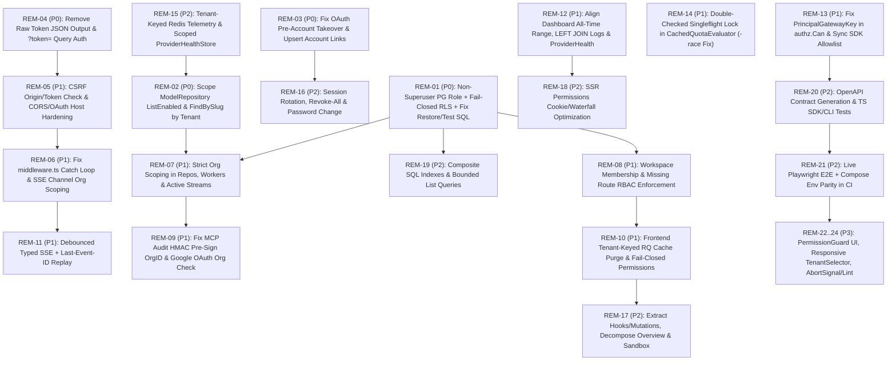

# RoozyLabs Prism — Prioritized Remediation Roadmap

**Baseline Commit:** `main` @ `e85566b6c5d188a1143cc6d425cd05dc4140c365` (`e85566b`)  
**Companion Report:** [prism-comprehensive-audit.md](./prism-comprehensive-audit.md) | [prism-readiness-matrix.md](./prism-readiness-matrix.md)

---

## 1. Milestone Strategy

The remediation plan minimizes blast radius by closing multi-tenant isolation, session security, and data-integrity blockers first (**Milestone 1**), stabilizing real-time updates, analytics accuracy, and SDK/CLI contracts second (**Milestone 2**), before addressing frontend decomposition, performance indexes, and E2E/CI automation (**Milestone 3 & Milestone 4**).

| Milestone | Scope | Release Gate Impact |
|---|---|---|
| **M1: Production Security & Isolation Gate** | All `4 P0` + critical security `P1` items (`REM-01` through `REM-10`) | **Hard blocker** for any multi-tenant deployment |
| **M2: Data Correctness, SSE & SDK Parity** | Remaining `P1` reliability, analytics, race & SDK items (`REM-11` through `REM-15`) | **Hard blocker** for GA / self-serve commercial traffic |
| **M3: Performance, Architecture & CI Hygiene** | `P2` lifecycle, indexes, proxy timeouts, CI/E2E (`REM-16` through `REM-21`) | Required for scale & operational maturity |
| **M4: UI Ergonomics & Code Cleanup** | `P3` UI polish, responsive switcher, lint warnings (`REM-22` through `REM-24`) | Non-blocking incremental cleanup |

---

## 2. Recommended Remediation Dependency Graph

---

## 3. Top 10 Highest-Leverage Remediation Tasks (Pre-Production Sequence)

1. **`REM-01` (`AUD-P0-01`) — Enforce Non-Superuser PostgreSQL Role, Fail-Closed RLS Policies, Driver Reset & Fix `pg-restore-test.sh` / `TestRLS` SQL**
2. **`REM-02` (`AUD-P0-02`) — Scope `ModelRepository.ListEnabled` & `FindBySlug` to Tenant/System Providers**
3. **`REM-03` (`AUD-P0-03`) — Block OAuth Pre-Account Takeover & Idempotently Upsert `account` Rows**
4. **`REM-04` (`AUD-P0-04`) — Remove Raw Session `token` from Browser Login/Signup JSON & Drop `?token=` Query Auth**
5. **`REM-07` (`AUD-P1-06`, `AUD-P1-07`, `AUD-P1-10`, `AUD-P1-11`) — Eliminate Cross-Org Leaks in MCP Registry, FinOps Workers, `GetAgentStats`/`PilotOutcomes` Fallbacks & Redis Active Streams**
6. **`REM-08` (`AUD-P1-08`) — Enforce `workspace_members`, Missing Route `RequirePermission` (6 routes) & Workspace/Project Scoping on Approvals/Jobs/Tools/Resources**
7. **`REM-09` (`AUD-P1-09`, `AUD-P1-12`) — Fix Inbound MCP Audit Trail HMAC `OrgID` Sign-Order Bug & Google Credential OAuth Org Validation**
8. **`REM-13` (`AUD-P1-16`) — Fix `PrincipalGatewayKey` Support in `authz.Can` & Reconcile SDK Routes with `GatewayKeyRoutes`**
9. **`REM-10` (`AUD-P1-13`) — Fix Frontend Cross-Tenant Cache Retention (`removeQueries` + Tenant `queryKey`s) & `PermissionContext` Fail-Closed Default**
10. **`REM-12` (`AUD-P1-14`, `AUD-P1-15`) & `REM-11` (`AUD-P1-04`, `AUD-P1-05`) — Fix Dashboard 3-Way "All Time" / `INNER JOIN` Bugs & SSE Cross-Org Channel + 29x Invalidation Storm** *(plus `REM-14` `-race` fix)*

---

## 4. Detailed Implementation Tasks by Priority

### P0 — Critical Security & Multi-Tenant Blockers

| Task ID | Finding(s) | Exact Target Files | Complexity | Dependencies |
|---|---|---|---|---|
| **`REM-01`** | `AUD-P0-01` | `docker-compose.yml`, `apps/api/migrations/115_*.sql`, `apps/api/internal/database/rls_driver.go`, `apps/api/internal/database/rls_role_verification_test.go`, `scripts/backup/pg-restore-test.sh` | **L** | None |
| **`REM-02`** | `AUD-P0-02` | `apps/api/internal/repository/model.go`, `apps/api/internal/handlers/{gateway,finops,simulate}.go`, `apps/api/internal/proxy/router.go` | **M** | `REM-01` (optional, ship in parallel) |
| **`REM-03`** | `AUD-P0-03` | `apps/api/internal/service/auth.go`, `apps/api/internal/repository/account.go`, `apps/api/migrations/116_*.sql` | **M** | None |
| **`REM-04`** | `AUD-P0-04` | `apps/api/internal/handlers/auth.go`, `apps/api/internal/service/auth.go`, `apps/api/internal/middleware/auth.go`, `apps/app/lib/api/client.ts`, `apps/app/context/AuthContext.tsx` | **S** | None |

**Acceptance Criteria & Required Regression Tests (P0):**
- **`REM-01`:** Runtime `api`/`api-green` containers connect as `prism_app` (`NOSUPERUSER NOBYPASSRLS`); RLS policies reject empty GUCs unless explicit worker flag; `rlsConn.ResetSession` resets session GUCs; `16` uncovered tenant tables get RLS; `go test -v ./internal/database -run TestRLS` and `bash scripts/backup/pg-restore-test.sh` pass against live Postgres 15.
- **`REM-02`:** Tenant B gateway keys & dashboard calls (`GET /v1/models`, `GET /api/analytics/finops`, `POST /api/routing/replay`, `Router.ResolveWithFallback`) see only system/own-org models; integration test verifies cross-tenant slug collision does not leak or block Tenant A.
- **`REM-03`:** OAuth callback matching an unverified (`email_verified = false`) `credential` account neutralizes or blocks attacker password login until ownership verified; `account` upsert test confirms repeated Google logins create 1 link row, never duplicates.
- **`REM-04`:** Browser `/api/auth/login` and `/api/auth/signup` return user metadata + `HttpOnly` cookie without plaintext session bearer token in JSON; `AuthMiddleware` returns `401` for `?token=` on `/api/*` routes.

---

### P1 — Correctness, Reliability, Isolation & SDK Parity

| Task ID | Finding(s) | Exact Target Files | Complexity | Dependencies |
|---|---|---|---|---|
| **`REM-05`** | `AUD-P1-01`, `AUD-P1-03` | `apps/api/internal/middleware/{csrf,cors}.go`, `apps/api/internal/handlers/{auth_oauth,oauth_handler}.go`, `apps/api/cmd/server/main.go` | **M** | `REM-04` |
| **`REM-06`** | `AUD-P1-02`, `AUD-P1-05` | `apps/app/middleware.ts`, `apps/api/internal/redis/events.go`, `apps/api/internal/handlers/sse.go`, all `.Publish(` call sites | **M** | `REM-05` |
| **`REM-07`** | `AUD-P1-06`, `AUD-P1-07`, `AUD-P1-10`, `AUD-P1-11` | `apps/api/internal/repository/{mcp_registry,cost_anomaly,budget,request_log,pilot_outcomes}.go`, `apps/api/internal/workers/{anomaly,budget_alerts}.go`, `apps/api/internal/redis/cooldown.go`, `apps/api/internal/handlers/{credential,model}.go` | **L** | `REM-01` |
| **`REM-08`** | `AUD-P1-08` | `apps/api/internal/middleware/tenant_hierarchy.go`, `apps/api/internal/handlers/{quota,gateway,approval,workspace}.go`, `apps/api/internal/repository/{approval,agent,tool,resource,mcp_server,governance_policy}.go`, `apps/api/internal/proxy/budget_manager.go`, `apps/api/cmd/server/main.go` | **L** | `REM-01` |
| **`REM-09`** | `AUD-P1-09`, `AUD-P1-12` | `apps/api/internal/handlers/{mcp_server,oauth_handler}.go`, `apps/api/internal/proxy/audit_recorder.go` | **S** | `REM-07` |
| **`REM-10`** | `AUD-P1-13` | `apps/app/components/{TenantSelector,PermissionProvider}.tsx`, `apps/app/hooks/queries/*.ts`, `apps/app/features/*/query-keys.ts` | **M** | `REM-08` |
| **`REM-11`** | `AUD-P1-04`, `AUD-P2-02` | `apps/app/context/SSEContext.tsx`, `apps/api/internal/handlers/sse.go`, `apps/api/internal/redis/events.go` | **M** | `REM-06` |
| **`REM-12`** | `AUD-P1-14`, `AUD-P1-15` | `apps/app/app/(dashboard)/page.tsx`, `apps/api/internal/handlers/dashboard.go`, `apps/api/internal/repository/request_log.go`, `apps/app/lib/api/types/dashboard.ts` | **M** | None |
| **`REM-13`** | `AUD-P1-16` | `apps/api/internal/authz/engine.go`, `apps/api/internal/middleware/{rbac,gateway_key_scope}.go`, `packages/sdk/src/{workspaces,analytics}.ts` | **M** | None |
| **`REM-14`** | `AUD-P1-17` | `apps/api/internal/proxy/{quota_cache,quota_cache_test}.go` | **S** | None |

**Acceptance Criteria & Required Regression Tests (P1):**
- **`REM-05`:** Mismatched `Origin` / `Sec-Fetch-Site: cross-site` blocked on cookie-auth mutations + logout (`403`); CORS preflight allows `X-Prism-Org-ID`, `X-Prism-Workspace-ID`, `X-Prism-Project-ID`, `Idempotency-Key`; OAuth `getBaseURL` uses configured `APP_PUBLIC_URL` in prod.
- **`REM-06`:** `middleware.test.ts` proves `/signin` does not redirect-loop when permissions fetch throws; SSE stream subscribes to org-scoped channel verified against org membership and filters cross-org events.
- **`REM-07`:** Zero cross-org leaks in `mcp_registry`, FinOps workers (`budget_alerts`, `cost_anomalies`), `GetAgentStats`/`GetAgentTotalSpendUSD`, and `PilotOutcomesRepository`; concurrent Tenant B streaming never blocks Tenant A credential/model deletes.
- **`REM-08`:** All 6 missing routes enforce `RequirePermission`; `TenantMiddleware` verifies `workspace_members` for non-admin users; single-item reads/executions (`approvals/:approvalId`, `jobs/:jobId`, tools, resources) enforce workspace scope when active.
- **`REM-09`:** `POST /v1/mcp` audit trails always pass `POST /api/audit-trail/:id/verify` HMAC check; Gemini OAuth credential flow permits org teammates with `credential:create` and denies cross-org providers.
- **`REM-10`:** Org/workspace/project switch purges stale cross-tenant caches; all domain `queryKey` values include tenant IDs; `PermissionContext` default fallback returns `VIEWER` / `false`.
- **`REM-11`:** Burst of 10 gateway events within 50ms triggers coalesced, event-specific invalidations (not 29 blanket refetches); `Last-Event-ID` replays missed events within 5m window; `sse.go` aborts wait immediately on disconnect/shutdown.
- **`REM-12`:** `'all'` queries identical consistent bounds across KPI stats, usage chart, log analytics, and pilot outcomes; `days=1` renders hourly buckets; deleting a gateway key does not shrink `GetStats`/`GetUsageChart`/`GetLogAnalytics`; `ProviderHealth.id` is serialized and `credCount === 0` marks `down`/`degraded`.
- **`REM-13`:** Every route in `GatewayKeyRoutes` + Paperclip register + allowlisted SDK routes pass integration tests using a `prism_sk_*` bearer key.
- **`REM-14`:** Re-check `c.entries` inside `DoChan` callback; `go test -race -count=20 ./internal/proxy/... -run TestCachedQuotaEvaluator` passes cleanly.

---

### P2 — Architectural Debt, Performance & CI/CD

| Task ID | Finding(s) | Exact Target Files | Complexity | Dependencies |
|---|---|---|---|---|
| **`REM-15`** | `AUD-P2-03` | `apps/api/internal/redis/telemetry.go`, `apps/api/internal/proxy/{health_store,router}.go` | **M** | `REM-02` |
| **`REM-16`** | `AUD-P2-01` | `apps/api/internal/service/auth.go`, `apps/api/internal/repository/session.go`, `apps/api/internal/handlers/auth.go`, `apps/api/internal/workers/retention.go` | **M** | `REM-03` |
| **`REM-17`** | `AUD-P2-04`, `AUD-P2-05` | `apps/app/app/(dashboard)/{page,sandbox/page,settings/organization/page}.tsx`, `apps/app/components/organisms/ClientOnboardingModal.tsx`, `apps/app/hooks/{queries,mutations}/*.ts` | **L** | `REM-10` |
| **`REM-18`** | `AUD-P2-07` | `apps/app/middleware.ts`, `apps/app/app/(dashboard)/layout.tsx`, `apps/app/stores/useTenantStore.ts` | **M** | `REM-10`, `REM-12` |
| **`REM-19`** | `AUD-P2-08` | `apps/api/migrations/117_*.sql`, `apps/api/internal/repository/*.go` | **M** | `REM-01` |
| **`REM-20`** | `AUD-P2-06`, `AUD-P2-10`, `AUD-P2-12` | `apps/api/internal/handlers/*.go`, `apps/api/internal/middleware/context.go`, `docs/openapi.*`, `apps/app/lib/api/{billing,quotas}.ts`, `packages/{sdk,cli}/` | **L** | `REM-13` |
| **`REM-21`** | `AUD-P2-09`, `AUD-P2-11` | `docker-compose.yml`, `.env.example`, `.github/workflows/{api-ci-cd,app-ci-cd,packages-ci}.yml`, `apps/app/e2e/*.spec.ts` | **M** | `REM-01`, `REM-20` |

**Acceptance Criteria & Required Regression Tests (P2):**
- **`REM-15`:** Redis model telemetry keys partitioned by `orgID` (or safe weighted global fallback separate from private slugs); `ProviderHealthStore` isolates tenant snapshots cleanly under non-superuser RLS.
- **`REM-16`:** Password change & "Revoke All Sessions" endpoints live with active session revocation tests; expired sessions pruned automatically.
- **`REM-17`:** Zero mutations left inside `hooks/queries/`; `sandbox/page.tsx` and `(dashboard)/page.tsx` decomposed into modular hooks/components (<350 lines per file); `ClientOnboardingModal` uses RHF+Zod with step rollback/idempotency.
- **`REM-18`:** Validated SSR org hint cookie eliminates org-role hydration mismatch and duplicate `/api/user/permissions` checks per navigation.
- **`REM-19`:** New indexes on `ai_audit_trails(org_id, created_at DESC)` and `request_logs(org_id, workspace_id, created_at DESC)`; growable list queries bounded with `LIMIT`; `EXPLAIN` checks added.
- **`REM-20`:** All 30 remaining raw `c.JSON` handler errors migrated to `httputil.Respond*`; `apiUpdateQuota` & `billing.ts` DTOs aligned; `openapi.json` covers all `/v1` + `GatewayKeyRoutes`; Vitest suites pass for `packages/sdk` and `packages/cli`.
- **`REM-21`:** CI executes live Playwright E2E against ephemeral API + DB + App stack, passes `backup-restore-drill`, passes explicit `AUDIT_HMAC_KEY` & `REDIS_FAIL_CLOSED` envs, and cleans localhost defaults from production templates.

---

### P3 — UI Quality & Minor Hygiene

| Task ID | Finding(s) | Exact Target Files | Complexity | Dependencies |
|---|---|---|---|---|
| **`REM-22`** | `AUD-P3-01` | `apps/app/app/(dashboard)/**/*.tsx` | **S** | `REM-10` |
| **`REM-23`** | `AUD-P3-02` | `apps/app/components/TenantSelector.tsx` | **S** | `REM-22` |
| **`REM-24`** | `AUD-P3-03`, `AUD-P3-04` | `apps/app/lib/api/*.ts`, `apps/app/lib/api/client.ts`, `apps/app/components/organisms/DataTable.tsx`, `apps/app/context/AuthContext.tsx` | **S** | `REM-04` |

**Acceptance Criteria & Required Regression Tests (P3):**
- **`REM-22`:** Privileged create/delete buttons across dashboard views wrapped in `<PermissionGuard permission="...">` with accessible disabled tooltips for `viewer` role.
- **`REM-23`:** Workspace and Project selectors accessible inside responsive header popover or mobile navigation drawer below `1280px`.
- **`REM-24`:** React Query `AbortSignal` threaded into `lib/api/*` reads + default Axios `30s` request timeout; `pnpm lint` warnings resolved cleanly (0 errors, 0 actionable a11y/hook warnings).

---

## 5. Post-Remediation Implementation Status (`2026-11-22`)

| Group | Tasks Covered | Implementation & Local Unit Status | Live Container / CI Status |
|---|---|---|---|
| **M1: Security & Tenant Isolation** | `REM-01`–`REM-10` | **Implemented & unit-verified** (includes `rlsConn.ResetSession` pool sync + `ErrBadConn`, OAuth hardening, CSRF/Origin checks, workspace RBAC, tenant-keyed RQ purge) | **Pending live Docker/CI** (PostgreSQL 15 `TestRLS` + `pg-restore-test.sh` & Redis 7; local Docker offline) |
| **M2: Correctness, SSE & SDK Parity** | `REM-11`–`REM-15` | **Implemented & unit-verified** (coalesced typed SSE + `Last-Event-ID`, consistent `all` range + `LEFT JOIN` logs, `PrincipalGatewayKey` RBAC, `-race`-safe `CachedQuotaEvaluator`, tenant telemetry) | **Pending live Docker/CI** (end-to-end live DB/Redis & live gateway-key integration verification) |
| **M3: Performance, Architecture & CI** | `REM-16`–`REM-21` | **Implemented & locally verified** (session rotation/revocation, decomposed Overview/Sandbox/Organization pages `< 350` lines + RHF/Zod, `prism_active_org` SSR pass-through, SQL indexes, OpenAPI/SDK/CLI suites, `.github/workflows/app-ci-cd.yml` ephemeral stack + `apps/app/e2e/dashboard.spec.ts`) | **Pending CI `playwright-e2e` run** (`PLAYWRIGHT_LIVE_E2E=1` skipped locally while live stack offline) |
| **M4: UI Ergonomics & Hygiene** | `REM-22`–`REM-24` | **Implemented & verified locally** (`PermissionGuard` keyboard/click blocking + all dashboard views guarded, responsive `TenantSelector`, `AbortSignal` across `lib/api/*` + `hooks/queries/*`, `pnpm lint` clean `0` errors / `0` warnings) | Complete locally; covered in E2E flows above |
