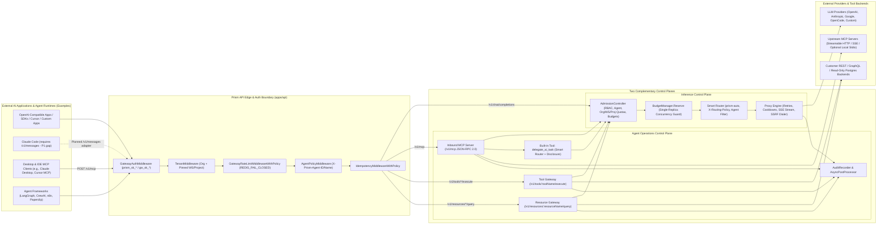
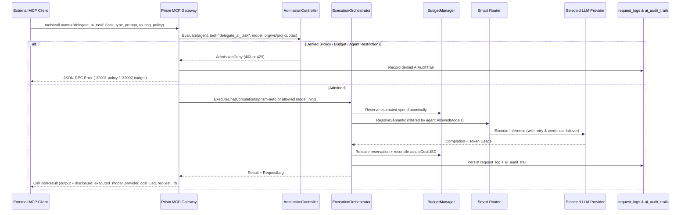
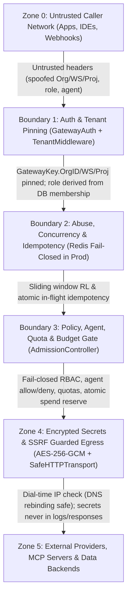

# Prism — Unified AI Control Plane: Product & Systems Architecture

**Repository:** `github.com/roozylabs27/prism` (`main` @ `0b7ea87` + Phase 4 security/control-plane hardening)  
**Positioning:** Infrastructure & Governance Layer Behind Supported AI Applications and Agent Runtimes

---

## 1. Product Vision & Positioning

Prism is a **Unified AI Control Plane** that helps organizations and AI automation agencies govern, route, meter, isolate, and audit their AI inference traffic and agent tool operations.

Prism does **not** replace user-facing AI applications, coding IDEs, or agent frameworks (such as Claude Code, Claude Desktop, Cursor, OpenAI-compatible clients, LangChain/LangGraph, CrewAI, AutoGen, n8n, or custom apps). Instead, Prism sits behind them as a dedicated control layer composed of two complementary planes:

1. **Inference Control Plane** — Governs model access, BYOK credentials, smart model routing, rate limits, failover, streaming, cost calculation, budgets, quotas, and observability.
2. **Agent Operations Control Plane** — Governs registered agent identities, tool/resource/MCP allowlists and deny rules, inbound MCP tool exposure, delegated subtask routing (`delegate_ai_task`), and compliance audit trails.

### Core Architectural Principle: Explicit Enforcement Boundaries

> Prism only claims to govern operations that physically cross its enforcement boundaries. Dashboard policies alone never constrain shell commands, local filesystems, or direct provider API calls that bypass Prism's endpoints.

---

## 2. Target Customer

- **Primary ICP (Initial Commercial Focus):** **AI Automation Agencies** managing **5–30 active client accounts** (chatbots, internal assistants, multi-step workflow automations, and custom agents across clients).
- **Secondary Adoption:** Engineering and platform teams requiring multi-provider failover, centralized BYOK credential isolation, spend caps, and auditable MCP tool governance.

---

## 3. High-Level Control Plane Architecture

---

## 4. Inference Control Plane Responsibilities

| Capability | Current Codebase Implementation (`apps/api`) | Boundary & Enforcement Status |
|---|---|---|
| **Universal AI Gateway** | `POST /v1/chat/completions`, `POST /v1/chat/completions/async`, `GET /v1/jobs/:jobId`, `GET /v1/models` (`cmd/server/main.go`, `handlers/gateway.go`). | Enforces auth, tenant scope, rate limits, idempotency, admission control. Anthropic `/v1/messages` and OpenAI `/v1/responses` are **not yet exposed**. |
| **Provider Abstraction** | `OpenAIAdapter`, `AnthropicAdapter`, `GoogleAdapter`, `OpenCodeAdapter`, `OpenAIResponsesAdapter` (`internal/proxy/`). | Outbound OpenAI works well; Anthropic, Google, and Responses adapters have known translation gaps (`thought_signature` leak, missing `max_tokens` default, broken tool/stream translation). |
| **Smart Router & Model Selection** | `Router.ResolveSemantic` & `ResolveWithFallback`, `classifier.go`, `scorer.go`, `health_store.go`, `X-Routing-Policy` (`handlers/gateway.go`). | Scores quality, cost, speed, task match, Redis latency telemetry, 24h provider health, budget penalty, and (after Phase 4) filters candidates by `agent.AllowedModels`. |
| **Credential & BYOK Governance** | AES-256-GCM encrypted credentials (`credentials`), key rotation CLI `cmd/reencrypt`, OAuth2 Google refresh (`proxy/oauth.go`), priority/LRU/round-robin selection. | Scoped primarily by `user_id` (plus `org_id` in some queries); SSRF dial-time protection (`security/ssrf.go`). |
| **Rate Limiting & Idempotency** | Redis sliding-window rate limiter & 24h Redis idempotency cache/lock (`REDIS_FAIL_CLOSED=true` default outside development). | Fails closed with `503` when Redis is down in production; fails open in `development` unless overridden. |
| **Budget & Quota Enforcement** | `BudgetManager` (monthly/daily hard/soft limits + Phase 4 single-replica in-flight reservation) & `CachedQuotaEvaluator` (org + Phase 4 workspace/project + daily request limits, fail closed). | Budgets in schema remain `user_id`-scoped; concurrency reservation is process-local (single replica). |
| **Failover & Cooldowns** | Redis per-credential cooldowns (429/401/403/3x5xx circuit threshold), pre-token SSE retry, bounded attempts (`MAX_RETRIES+1`). | Active per-credential quarantine; no half-open probe or provider-level circuit breaker. |
| **Usage Metering & Observability** | `request_logs`, `routing_decisions`, `ai_audit_trails`, Prometheus `/metrics` (bearer-protected), structured `slog` JSON logs with correlation IDs. | `TTFTMs` not persisted to `request_logs` on streams; `ai_audit_trails` async hashes use metadata surrogates rather than raw prompt/response; Tempo/Loki collectors lack config/traces. |

---

## 5. Agent Operations Control Plane Responsibilities

| Capability | Current Codebase Implementation | Enforcement Boundary |
|---|---|---|
| **Agent Identity & Registration** | `agents` table + CRUD `/api/agents*`, Paperclip adapter `/v1/adapters/paperclip/*`. Resolved via `X-Prism-Agent-ID`, `X-Prism-Agent-Name`, `X-Agent-Name`. | **Opt-in header:** Omitting agent headers yields `agent = nil` (gateway keys are not bound to an agent yet). `X-Paperclip-Agent-ID` still bypasses `AgentPolicyMiddleware`. |
| **Agent Permission Model** | `AllowedModels`, `AllowedTools`, `AllowedResources`, `AllowedMCPServers` (with `!name`/`-name`/`deny:` deny syntax), `MaxBudgetCents`, `Enabled`. | Enforced via `AdmissionController` across `/v1/chat/completions`, `prism-auto` candidate filtering, `/v1/tools/*`, `/v1/resources/*`, and `/v1/mcp` (including short & qualified tool names). |
| **Inbound MCP Gateway (`POST /v1/mcp`)** | Phase 4 `MCPServerHandler` (`internal/handlers/mcp_server.go`) implementing JSON-RPC 2.0 Streamable HTTP (`initialize`, `tools/list`, `tools/call`, `ping`). | Authenticates gateway keys, enforces tenant/agent/RBAC/quota/budget checks prior to proxying upstream `<server>__<tool>` calls via `proxy.MCPGateway`, writes compliant/denied `ai_audit_trails`. |
| **Outbound MCP Client** | `proxy.MCPGateway` (`mark3labs/mcp-go/client`) supporting Streamable HTTP (SSRF-guarded), SSE (SSRF-guarded), and local stdio (`MCP_LOCAL_STDIO_ENABLED=false` default). | Secrets decrypted only inside gateway runtime; `GET /api/mcp/servers/:id` masks sensitive headers on read (`handlers/mcp.go`). Chat completion `engine.go` does not autonomously loop/execute MCP tool calls. |
| **Tool & Resource Gateways** | `/v1/tools/:toolName/execute` and `/v1/resources/:resourceName/query`. | Phase 4 wired `AdmissionController`, deny rules (`!deny`), and `AuditRecorder`. |
| **Approval Workflows** | **Not implemented** (0% backend/schema/UI support; `governance_policies.effect` allows only `"allow"` or `"deny"`). | Human-in-the-loop approval for sensitive tools is on the P1 roadmap. |

---

## 6. Separation of Smart Router & MCP Gateway

Smart Router and MCP Gateway solve **orthogonal** layers of AI infrastructure and must never be conflated:

1. **Smart Router (`Router.ResolveSemantic`)** answers *"Which LLM model, provider, and credential should process this inference prompt?"* based on task classification, quality/cost/speed weights, live latency/health, agent model allowlists, and budget state.
2. **MCP Gateway (`MCPServerHandler` + `MCPGateway`)** answers *"Which external tools can this agent discover (`tools/list`) and invoke (`tools/call`), under which upstream credentials, and with what authorization and audit logging?"*

External clients in the ecosystem interact with either or both:
- **Inference-capable clients** (OpenAI-compatible apps, LangChain, CrewAI, n8n, custom backends, Cursor with custom endpoint, and Claude Code once `/v1/messages` is added) route LLM completions through **AI Gateway → Smart Router**.
- **MCP-capable clients** (Claude Desktop, Cursor MCP, Claude Code MCP, custom MCP agents) connect to **`POST /v1/mcp`** to access governed tools (`<server>__<tool>`). Connecting an app via MCP **does not** hijack or replace that app's primary chat model selection in its own UI.

---

## 7. Integration Architecture Across a Heterogeneous Ecosystem

*Claude Desktop is one representative desktop MCP client in a multi-platform ecosystem — not the center of Prism's design.*

1. **Claude Code (`ANTHROPIC_BASE_URL`):** Designed to route inference through an Anthropic Messages-compatible `/v1/messages` endpoint. **Verified Gap:** Prism does not yet expose `POST /v1/messages` (`cmd/server/main.go:558-577`), so native Claude Code inference routing is **currently unsupported** (P1 priority). Claude Code *can* connect to Prism as an HTTP MCP server (`POST /v1/mcp`) for governed tool execution.
2. **Desktop / IDE MCP Clients (e.g., Claude Desktop, Cursor MCP):** Primary conversation models (e.g., Claude Opus/Sonnet in Claude Desktop or Cursor's managed model picker) often go directly to the client's vendor unless a custom OpenAI/Anthropic base URL is configured and compatible. Prism delivers immediate value via **MCP Gateway (`POST /v1/mcp`)** for tool governance + **`delegate_ai_task`** for routed subtask offloading.
3. **Custom AI Apps, Agent Frameworks (LangGraph, CrewAI, AutoGen, OpenAI Agents SDK) & Automation Platforms (n8n):** Point OpenAI-compatible SDK `base_url` to Prism `/v1` for **full Inference Control Plane governance** (`prism-auto` or explicit model pinning, `X-Routing-Policy`, budgets, failover) AND optionally attach `POST /v1/mcp` or `/v1/tools/*` for **Agent Operations Control**.

---

## 8. Delegated AI Task Architecture (`delegate_ai_task`)

When an application keeps its primary reasoning model (for example, Claude Desktop running Opus or an IDE agent running a flagship coding model), it can still leverage Prism's Smart Router, cost optimization, and multi-provider pool via the built-in MCP tool **`delegate_ai_task`**:

### Mandatory Disclosure & Contract Guarantees
- Explicit input schema: `task_type` (`classification`, `extraction`, `summarization`, `structured_generation`, `analysis`, `coding`, `general`), non-empty `prompt` (bounded at 100,000 chars), optional `system_prompt`, `routing_policy`, `model_hint`, `max_tokens`, `temperature`, `output_format`.
- Explicit disclosure payload returned in tool output + response headers (`X-Prism-Model`, `X-Prism-Provider`, `X-Request-ID`): `{ output, disclosure: { executed_model, executed_provider, routing_policy, task_type, request_id, latency_ms, usage: { prompt_tokens, completion_tokens, total_tokens, cost_usd } } }`.
- Never claims to route or inspect the parent client's native chat turns that did not invoke `delegate_ai_task`.

---

## 9. Trust & Security Boundaries

1. **Client headers cannot widen identity or privilege:** `GatewayKey.OrgID`, `WorkspaceID`, and `ProjectID` override/reject conflicting `X-Prism-*` headers (`middleware/tenant.go`). Client-supplied role headers are ignored; governance role comes from `organization_members` (`handlers/gateway.go`).
2. **Execution-time secret isolation:** Provider API keys and upstream MCP auth headers stay AES-256-GCM encrypted at rest and are masked on read (`handlers/mcp.go`, `handlers/credential.go`).
3. **SSRF & DNS rebinding protection:** Outbound provider, tool, resource, and remote MCP HTTP requests traverse `security.SafeHTTPTransport`, validating resolved IPs at dial time (`security/ssrf.go`). Local stdio MCP spawning and Postgres resource backends default to **disabled** (`MCP_LOCAL_STDIO_ENABLED=false`, `RESOURCE_POSTGRES_ENABLED=false`).
4. **Unenforced Boundary Disclaimer:** Prism **cannot** inspect or block requests sent directly from a runtime to `api.openai.com` / `api.anthropic.com`, nor can it sandbox arbitrary shell commands run inside a client's local agent host unless those tools are invoked through Prism's gateway.
